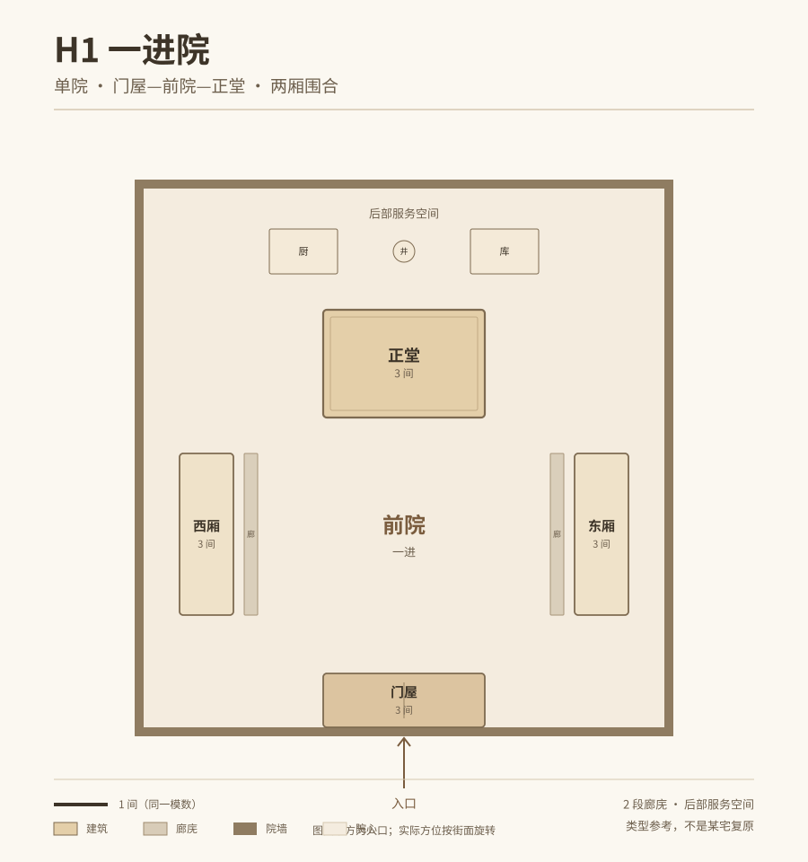
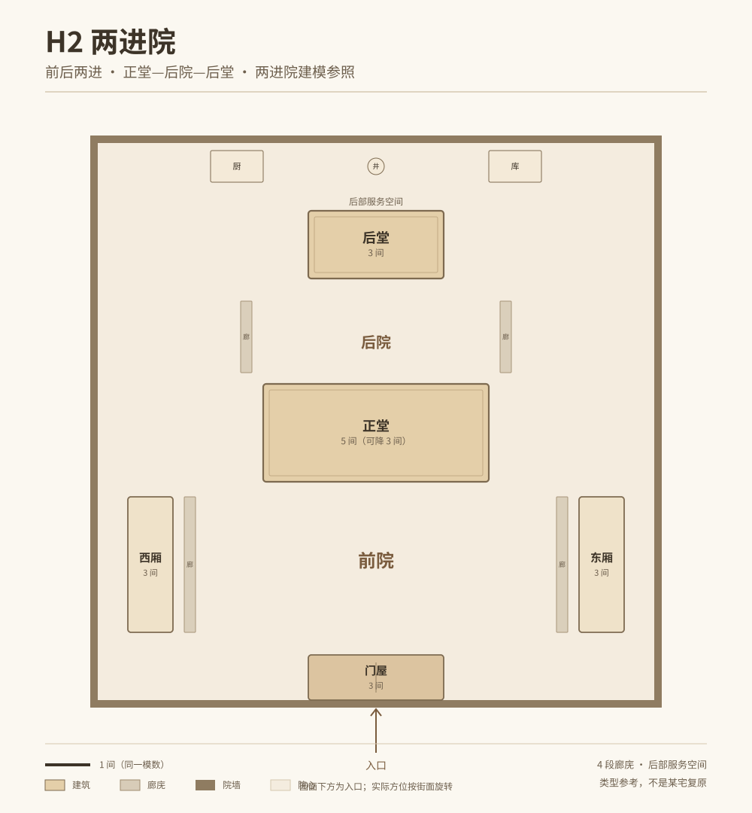
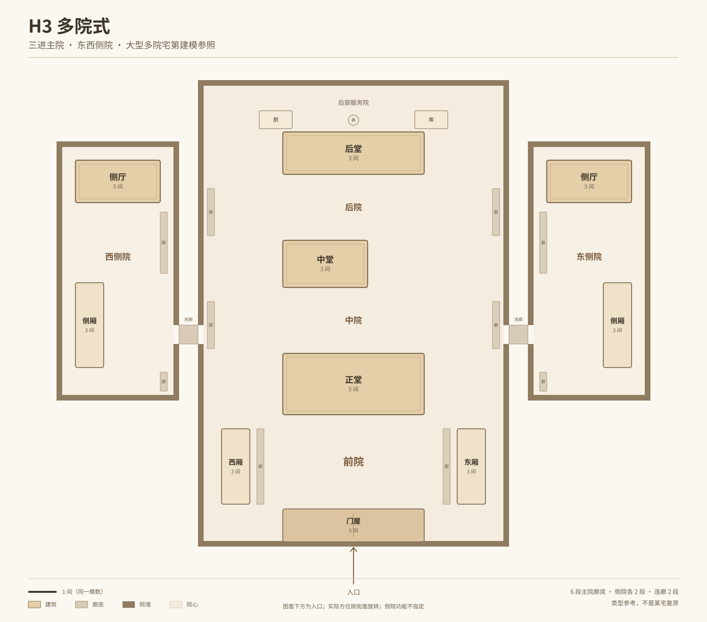

# 宅第院落类型参考 H1–H3（项目建模用）

[手册入口](README.md) · [住宅与宅第](residences.md) · [资料索引](sources.md)

**性质：** 本页是项目内部建模参考，不是唐人称谓、考古类型学或官品等级表。H1–H3 是项目内部编号，只描述院落规模与构件组合，不回答居住者身份、官品或年代，也不能从类型反推这些信息。

**用途：** 给具体宅第只有方位、没有院落构成时，提供一套可复用的空间骨架。建模时先按类型补齐，再逐项用本址材料替换；不能把类型补足写成某宅史实。

**不是：** 不是官品等级表，不是某座宅第的复原平面，也不是天宝所有宅第的统计平均。官品、爵位和《营缮令》只作上限参考，不直接决定类型。

三型各有一张独立图，**同一模数**：H1 画布最小，H2 中等，H3 最大。比较时看门屋、正堂、厢房的相对尺寸，不要按屏幕同宽比较。

**模数：** 1 间 = 60 单位是图面模数，不是唐尺，也不换算米；三张图只用于比较相对体量。

- [H1 一进院](figures/residence-type-h1.svg)
- [H2 两进院](figures/residence-type-h2.svg)
- [H3 多院式](figures/residence-type-h3.svg)

## 0. 使用边界

- **建模默认满配。** 类型参考默认列出门屋、正堂、厢房、廊庑、院墙和后部服务空间；这是建模起点，不是历史通例，也不因本宅没有记载就视为已证实。
- **具体项目做减法。** 只有材料明确否定，或地块确实放不下，才减项；减项要记录理由。
- **不跨级套用。** H3 不能因为“房间多”就硬塞进 H1 的地块；H1 也不能靠增加一栋后堂冒充 H2。
- **不写米制尺寸。** 表中的“间”是开间数，不是面积；“段”是廊庑的分段，不是精确长度。院墙只定围合，不定高度和厚度。
- **不指定功能。** 侧院、厢房、后堂只给类型，不自动写成书房、家庙、佛堂、马厩或某人的居室。后部服务空间中的厨、库、井也只是占位名，不表示本址一定有这些建筑。
- **不以李林甫宅为依据。** 本表不使用李林甫宅的院内记载，也不把月堂、嘉猷观等个案写进通用参考。

### H0：不套用类型

H0 不是第四种院落，而是一条降级规则：

- 地块放不下一进完整院，或材料完全不足以判断院落规模时，标为 H0。
- H0 只表示“未定”，不画门屋—正堂骨架，也不拿 H1 硬填。
- 需要给建模一个占位体量时，另立“未定院落”占位，不混入 H1–H3。

## 1. 三型总表

| 类型 | 院落 | 主院建筑 | 围合与附属 | 适用 |
| --- | --- | --- | --- | --- |
| **H1 一进院** | 1 进 | 门屋、正堂 | 东西厢、2 段廊庑、院墙、后部服务空间 | 地块较小，或材料只支持单院 |
| **H2 两进院** | 2 进 | 门屋、正堂、后堂 | 东西厢、4 段廊庑、院墙、后部服务空间 | 两进院建模参照 |
| **H3 多院式** | 3 进主院 | 门屋、正堂、中堂、后堂 | 东西厢、6 段廊庑、东西侧院、连廊、后部服务院、院墙 | 大型多院宅第建模参照 |

三型不是官品表。同一官品可因地块、旧宅沿用或赐第而采用不同院落规模；不能从官品反推类型，也不能从类型反推居住者身份。类型只回答“院落骨架有多大”，不回答“宅主是谁”。

## 2. H1：一进院

**定性：** 单院、单主堂。门屋—前院—正堂，两厢围合，正堂后部带服务条带。

### 2.1 构件

| 构件 | 数量 | 位置 | 参考开间 |
| --- | --- | --- | --- |
| 门屋 | 1 | 南侧或临街面 | 3 间 |
| 东厢 | 1 | 前院东侧 | 3 间 |
| 西厢 | 1 | 前院西侧 | 3 间 |
| 正堂 | 1 | 中轴，前院之后 | 3 间 |
| 廊庑 | 2 段 | 前院东西两侧 | 窄于厢房 |
| 院墙 | 1 圈 | 外周 | — |
| 后部服务空间 | 1 处 | 正堂之后或侧后 | 厨、库、井为占位名 |

### 2.2 平面关系



门屋—前院—正堂；两厢围合，正堂后部为服务条带。图面下方为入口，不表示绝对南北；实际建模按街面方向旋转。

### 2.3 适用与降级

- 地块只够一进，或材料只支持“门—堂—厢”时，用 H1。
- H1 是完整的一进院，不是 H2 的残缺版；不要因为“官大”就强行加后堂。
- 连 H1 都放不下时，退回 H0，不画类型骨架。

### 2.4 不能证明

- 不能证明某宅只有一进；H1 是类型下限，不是历史结论。
- 不能证明门屋一定三间、正堂一定三间；开间只是建模参考。
- 不能证明后部服务空间一定在正堂之后；它只表示“应有服务空间”，厨、库、井只是占位名。

## 3. H2：两进院

**定性：** 门屋—前院—正堂—后院—后堂。前后院两侧都有廊庑，后部带服务空间。H2 是两进院的建模参照，不是所有两进宅第的实测。

### 3.1 构件

| 构件 | 数量 | 位置 | 参考开间 |
| --- | --- | --- | --- |
| 门屋 | 1 | 南侧或临街面 | 3 间 |
| 东厢 | 1 | 前院东侧 | 3 间 |
| 西厢 | 1 | 前院西侧 | 3 间 |
| 正堂 | 1 | 中轴，前院之后 | 5 间（上限型参考，可降 3 间） |
| 后堂 | 1 | 正堂之后 | 3 间 |
| 廊庑 | 4 段 | 前院、后院两侧 | 窄于厢房 |
| 院墙 | 1 圈 | 外周 | — |
| 后部服务空间 | 1 处 | 后堂之后或侧后 | 厨、库、井为占位名 |

H2 的正堂五间是上限型参考，便于给较高等级宅第留余量；不表示 H2 对应三品以上，也不表示五间是常态。保守建模可用三间。

### 3.2 平面关系



门屋—前院—正堂—后院—后堂；前后院两侧各两段廊庑。图面下方为入口，不表示绝对南北；实际建模按街面方向旋转。

### 3.3 适用与升降

- 地块能容两进，且材料支持“前堂后堂”或至少不否定后堂时，用 H2。
- H2 的核心不是“多一个后堂”，而是前后两进、四段廊庑和后院服务空间共同形成完整院落；只画门屋、正堂、后堂三座房子仍然会空。
- 地块放不下两进时降 H1；不要压缩成“没有院子的 H2”。
- 加一个完整侧院可升 H3；只加一个小库房或窄侧廊，仍是 H2。

### 3.4 不能证明

- 不能证明某宅正堂一定五间；五间是 H2 的上限型建模参考，取《营缮令》三品以上上限附近，不是某宅实测，也不是常见值。保守建模可用三间。
- 不能证明后堂一定存在；H2 是类型参照，具体宅第仍以材料为准。
- 不能证明后院服务空间的精确位置；厨、库、井只是占位名，不表示本址一定有这些建筑。

## 4. H3：多院式

**定性：** 三进主院，东西各一组侧院，后部独立服务院。H3 不是“H2 放大”，而是出现独立的侧院或第三进院落。

### 4.1 主院中轴

| 构件 | 数量 | 位置 | 参考开间 |
| --- | --- | --- | --- |
| 门屋 | 1 | 南侧或临街面 | 5 间 |
| 东厢 | 1 | 前院东侧 | 3 间 |
| 西厢 | 1 | 前院西侧 | 3 间 |
| 正堂 | 1 | 前院之后 | 5 间 |
| 中堂 | 1 | 中院之后 | 3 间 |
| 后堂 | 1 | 后院之后 | 3 间 |
| 廊庑 | 6 段 | 前院、中院、后院两侧 | 窄于厢房 |
| 院墙 | 1 圈 | 外周及院区隔墙 | — |

“中堂”是类型名，不表示某座宅第真有这个匾额。

### 4.2 侧院与后部

| 区域 | 构件 | 数量 | 说明 |
| --- | --- | --- | --- |
| 东侧院 | 侧厅 1、侧厢 1、廊庑 2 段、院墙 | 1 组 | 功能不指定 |
| 西侧院 | 侧厅 1、侧厢 1、廊庑 2 段、院墙 | 1 组 | 功能不指定 |
| 连廊 | 连接侧院与主院 | 2 段 | 只表示连通，不定走向 |
| 后部服务院 | 厨、库、井为占位名 | 1 处 | 在后堂之后或侧后；具体功能不指定 |

侧厅、侧厢参考各 3 间。

### 4.3 平面关系



三进主院居中，东西侧院附于两侧；侧院各以连廊接主院。连廊只表示连通，具体位置按地块调整；图面下方为入口，不表示绝对南北。

### 4.4 适用与升降

- 三进主院，或 H2 加一个完整侧院，用 H3。
- H2 加一个小库房、窄侧廊或一排辅助房，不自动升 H3；要有独立院落才算。
- 地块只够三进主院、放不下侧院时，记为“H3 主院变体（侧院减项）”，不标完整 H3；在数据中记录减项理由。
- 侧院功能不指定；没有材料时，不写书房、家庙、佛堂、马厩等具体用途。

### 4.5 不能证明

- 不能证明某宅一定有三进或侧院；H3 是大型多院宅第的建模参照。
- 不能证明中堂、后堂的真实名称；它们只是空间序列的类型名。
- 不能证明侧院的功能和归属；侧院只表示“另有独立院落”。

## 5. 升降级规则

| 情形 | 处理 |
| --- | --- |
| 地块能容三进，或 H2 加完整侧院 | H3 |
| 地块能容两进，不能容侧院 | H2 |
| 地块只容一进 | H1 |
| 连一进完整院都放不下 | H0 |
| H2 只加小库房、窄侧廊 | 仍是 H2 |
| H3 侧院放不下 | 记为“H3 主院变体（侧院减项）”，不标完整 H3 |
| 具体材料明确否定后堂 | 降 H1，并记录否定依据 |

升降级只改空间骨架，不改证据等级。

## 6. 建模默认满配与减项

### 6.1 建模默认满配

- H1：门屋、两厢、正堂、2 段廊庑、院墙、后部服务空间。
- H2：门屋、两厢、正堂、后堂、4 段廊庑、院墙、后部服务空间。
- H3：门屋、两厢、正堂、中堂、后堂、6 段廊庑、东西侧院、连廊、后部服务院、院墙。

### 6.2 减项记录

减项时至少记录：

```text
类型：H2
减项：后堂
理由：本址材料明确只有一进，或地块深度不足
处理：降为 H1，不保留“无院后堂”
```

类型补足部分建议在数据中标记：

```text
type_reference: H2
type_element: true
evidence: none
```

具体本址材料则保留原有证据等级，不因为套了类型就升级。

## 7. 禁止项

以下内容不进入 H1–H3 参考，必须由具体材料触发：

- 马厩
- 园池
- 楼阁
- 家庙
- 具体堂名
- 倒座、后罩、影壁
- 具体居住者、官品与院落面积的对应关系

## 8. 证据来源与限度

| 依据 | 能支持 | 不能支持 |
| --- | --- | --- |
| [S01](sources.md#s01) 布政坊院落墙、水井、水缸 | 院墙、井、生活服务设施的存在 | 完整宅院平面；宅第通式 |
| [S03](sources.md#s03) 安仁坊宅邸多院、长廊、散水、排水沟 | 多院相连、廊道连接、排水设施 | 精确院宽、房址尺寸；所有宅第都如此 |
| [S04](sources.md#s04) 《营缮令》堂舍、门屋开间上限 | 门屋、堂舍的开间上限参照 | 某宅实际开间；天宝当年的制度原貌 |
| [S03](sources.md#s03) 安仁坊遗址展示馆 | 唐代宅院形式的现代展示参照 | 考古复原平面；某宅史料 |

补充说明：

- 《营缮令》引自元和十二年（817）奏文，晚于天宝；只能作上限背景，不能反推天宝某宅。
- 安仁坊宅邸是“高等级”判断，不是所有宅第的统计样本；其多院、长廊可支持 H2/H3 的院落层次，但不能量取院宽。
- 现代复原图和展示建筑只帮助控制体量，不能当史料。
- 本表不引用李林甫宅；李宅只可后续做套用检验，不能反过来定义 H2。

## 9. agent 使用流程

1. **先判院落规模。** 有地块、遗迹或明确院落数时，按 H1/H2/H3 选择；没有就选 H0。
2. **建模默认满配。** 从对应类型的完整构件表开始，不先删空；补足部分明确标为类型参考。
3. **逐项替换。** 有本址材料的部分，用材料替换类型；没有的部分保留 `type_element: true`。
4. **放不下就降级。** H3 → H2 → H1 → H0；不要压缩院落硬塞。
5. **记录加减项。** 每次删项、加项都写理由，避免下一轮把类型补足误当史料。
6. **输出时分层。** 史料、推断、类型补足分开标注；类型补足不进入证据等级。

类型参考只补空间骨架，不补史实；它只能避免“院子太空”，不能证明这座宅子历史上就是这样。
