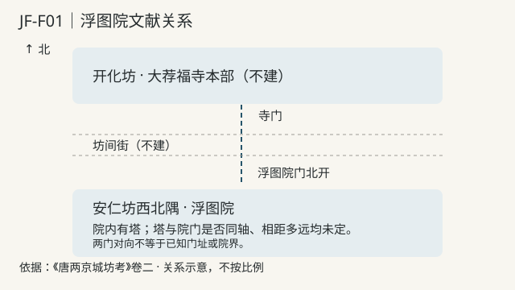

# 荐福寺浮图院复原 · 天宝九载（750）

**能用于天宝复原的，首先是塔院的位置关系、北开院门和十五级砖塔的基本形制；院界、门塔间距、逐级檐高与塔刹原状均未定。**

[建筑群复原模板](../ensemble-template.md) · [来源索引](sources.md) · [小雁塔详条](pagoda.md) · [院内单体卡](buildings.md) · [资产清单](asset-register.csv)

## A0 编纂说明

- **目标时点**：天宝九载（750），与[天宝长安全城项目](../README.md)一致。早期记载用于判断该时点的存在和形制；宋金、明及近现代材料另列，不直接回填盛唐。
- **历史范围**：“荐福寺”在本专项指安仁坊西北隅的**浮图院**。隔街的开化坊大荐福寺本部只作对向参照，不纳入复原。今景区的殿院序列也不作唐代塔院的建筑清单。
- **交付与裁切**：考证随附一套外观灰模方案说明，观看范围以北门内侧、院面和塔外为主。不建街道、坊墙、寺本部或现代景区，不开放登塔或地宫；场景裁切不表示历史院界。
- **坊级衔接**：仓内尚无可引用的安仁坊专项编号或固定总图。本版以北宋《长安志》[JF-S12](sources.md#jf-s12) 及清《唐两京城坊考》[JF-S01](sources.md#jf-s01) 作文字定位，以发掘团队简报 [JF-S13](sources.md#jf-s13) 作外围考古参照；局部坐标未与全城底图配准。

## A1 沿革与分期

| 年代／阶段 | 对象与事件 | 出处定位、材料时间与核验状态 | 本期用途 |
| --- | --- | --- | --- |
| 文明元年（684）、天授元年（690） | 开化坊本部立为大献福寺，后改荐福寺 | 北宋宋敏求《长安志》卷七开化坊条 [JF-S12](sources.md#jf-s12)，已核在线本 | 区分本部建寺与安仁坊营建；本部译经和放生池不能移入塔院 |
| 景龙年间（707–710） | 浮图院营立；宫人出资起塔十五层 | 《长安志》卷七 [JF-S12](sources.md#jf-s12)、《唐两京城坊考》卷二 [JF-S01](sources.md#jf-s01)；北宋张礼《游城南记》观塔条张注 [JF-S11](sources.md#jf-s11)。已核在线文本，皆为后世追述 | 支持天宝已有塔院与砖塔，十五级作为基本轮廓约束；不支持精确完工年或各级尺寸 |
| 中唐文字见证（成篇确年未定） | 柳宗元记“長安薦福浮圖”，并提到塔下室宇 | 《柳宗元集》卷十六《鶻说》[JF-S16](sources.md#jf-s16)，已核在线本 | 提供唐代文字见证，但不据文学叙事定附屋位置或断为 750 年 |
| 北宋 | 张礼记入圣容院观荐福寺塔；塔以东另有 1118、1120 年纪年砖志资料 | 《游城南记》观塔条 [JF-S11](sources.md#jf-s11)；宋墓发掘公开报道 [JF-S17](sources.md#jf-s17) | 分列同址塔院记载与外围遗存；不把邻近宋墓划入塔院 |
| 北宋政和六年（1116） | 塔外“周徊副屋”受损后修完 | 《大荐福寺重修塔记》，据 2024 年转引 [JF-S07](sources.md#jf-s07)；可追查新刊碑录 [JF-S15](sources.md#jf-s15)，原件与拓片未核 | 支持北宋已有塔外附属构筑物，不定始建年或柱网 |
| 金代至金末 | 续注称贞祐乙亥（1215）“塔之纏腰尚存”；又有“辛卯遷徙，廢蕩殆盡，惟磚塔在焉” | 《游城南记》同条无名续注 [JF-S11](sources.md#jf-s11)，直接核在线文本；“辛卯”据四库提要推为 1231 年 | 异期参照；不把后一句当作副阶毁坏年份，也不据此认定“缠腰”就是宋碑所记构筑物的同一施工阶段 |
| 明正统十四年（1449） | 《礼部劄付及荐福殿堂图》提供塔顶与明代布局图像线索 | [JF-S07](sources.md#jf-s07) 所载图像，原碑未核 | 仅作明代图像参照，不从图量取天宝塔刹 |
| 明嘉靖三十四年末（公历 1556） | 华州地震造成塔顶损毁；现已缺第 14、15 级 | [JF-S10](sources.md#jf-s10) 已核 2017 年公开介绍，未核震损原始记录 | 区分现存和失落段；不由现状倒推原檐高或刹高 |
| 明清 | 本址西北发现后世荐福寺院墙、围沟及院外瘗埋；康熙碑有补修塔基线索 | 2021–2022 年发掘所见，见 [JF-S08](sources.md#jf-s08)；碑名及内容见 [JF-S07](sources.md#jf-s07) 转述 | 区分异期院界与塔基改修，不回填盛唐 |
| 20 世纪修缮、测量与现状 | 1963–1965 年整修；公开资料载残高 `43.395 m`，另见 `43.3 m` | [JF-S14](sources.md#jf-s14) 修前照片图注与 [JF-S02](sources.md#jf-s02)、[JF-S07](sources.md#jf-s07)、[JF-S10](sources.md#jf-s10) 转述；原修缮、测绘档案未核，1989 测年仅见 JF-S07 | 同址现状参照；尺寸不能标为唐代实测，残高不能直接作为第 13 级檐上口 |

## A2 对象总表与建筑群布局

| 编号与名称 | 归属 | 本期存在状态 | 位置／关系精度 | 出处与纳入方式 |
| --- | --- | --- | --- | --- |
| JF-01 荐福寺塔（小雁塔） | 浮图院 | 有据 | 坊内可到西北隅，知在院内；唐代院内坐标未定 | [JF-S01](sources.md#jf-s01)、[JF-S11](sources.md#jf-s11)；核心单体，见 A3 |
| JF-02 北开院门 | 浮图院 | 有据；门屋未定 | 北开，与本部寺门隔街相对；门址和门塔关系未定 | [JF-S01](sources.md#jf-s01)；采用方向和对向关系，灰模门屋另列 |
| JF-03 院墙 | 浮图院展示范围 | 目标期形制及墙线未定 | 有明清院墙遗存，未落实唐代墙段或闭合院界 | 展示围合，非坊墙或后世院墙；[附属卡](buildings.md#jf-03-院墙) |
| JF-04 院面与步道 | 浮图院展示范围 | 唐代地坪、铺装和路径未定 | 地坪高程、坡度及街院高差均未落实 | 展示动线；[附属卡](buildings.md#jf-04-院面与步道) |
| JF-05、JF-07 东西附屋 | 展示备选，不作历史归属 | 已查未见可定址的目标期单体 | 两侧镜像是方案设定 | [JF-S06](sources.md#jf-s06) 仅作类型参照；默认关闭 |
| JF-06 塔副阶 | 塔周展示备选 | 后世有附属构筑物线索；750 年未定 | 仅能定性联系塔周，未落实柱础、开间与屋面 | [JF-S07](sources.md#jf-s07)、[JF-S11](sources.md#jf-s11)；默认关闭 |

### 空间关系

- **坊街与出入口**：北宋《长安志》已记“院門北開正與寺門隔街相對”，开化坊条把本部记在该坊南半。[JF-S12](sources.md#jf-s12)、[JF-S01](sources.md#jf-s01) 可确定门向和两门对向关系，不能确定坐标、门间距或门屋尺度。
- **外围考古**：发掘团队测得北坊墙角门距坊西北角约 `13 m`，未见墩台、门宽不详；门外有 `HD1` 涵洞，第七横街 `L1` 南北向发掘残宽约 `23.6 m`。简报推测角门是浮图院的便门，尚不能把它认作上述北开院门；街道残宽不等于两门净距。外围遗迹编号、尺寸、分期及可查图版见 [JF-S13](sources.md#jf-s13)；不把旧报道的塔距朱雀大街中轴约 `190 m` 用作配准点。[JF-S08](sources.md#jf-s08)
- **院界与分院**：明清荐福寺西北院墙和围沟不能回填唐代院界；已查文献和公开发掘材料尚不能定出目标期院墙线、进数或闭合地块。坊墙、明清院墙和灰模围合是三个不同对象。
- **轴线与单体关系**：两门隔街相对不等于院门与塔同轴；也不能据此推断副阶、东西房或后殿对称排列。正殿、钟鼓楼、经藏、僧房及围廊未落实到本院目标期，不纳入本版。
- **地坪与高差**：唐代院面、街面、排水坡度以及初建台面高程未定；方案仅用平院建立局部竖向基准。

### 总平面

**正式布局图待补。** 目前用文献关系图占位，只说明浮图院北门与大荐福寺本部寺门隔街相对，不按比例，不表示院界、门址或院内建筑的位置。

既有灰模参数见 A4。局部原点取塔身中轴在项目院面的投影；`X` 向东、`Y` 向北、`Z` 向上，单位米。`Z=0` 是展示地坪，不是唐代地面标高；未作考古或地理坐标配准。

## A3 重点单体详条

### JF-01 · 荐福寺塔

- **分期与辨识**：景龙所建塔是浮图院的核心。张礼注追记十五层，结合本址现存方形密檐砖塔作基本形制判断。现存十三层、塔顶有缺失；首层门楣、台基、券洞等现貌不能一概定为初建原件。
- **平面与通行**：采用方形砖砌承重塔身和平面居中的方台。塔脚按砖身外皮，台基按台身外沿，两者不混量。南北券门和南北踏步借本址现状作形制参照；原踏步边线、券口净尺寸和登塔路线未定。
- **分面立面（B1）**：南、北面依现状参照表现首层券门和上部券窗，东、西面不把南北券口直接复制过去。首层较高，上部各级密檐并收分。第 1–13 级逐级数据不是实测；第 14、15 级的开口、檐线与塔刹单列为缺失段的展示补全。详见[逐级审校](pagoda.md#塔高与逐级尺寸审校)。
- **剖面与构造（B2）**：现状资料可作砖身中空、首层南北券洞连向塔腔的参照；[首层纵剖](figures/pagoda-section.svg)只示台面至首层局部，方腔尺度和墙厚是展示推定，图中引断不是楼板。公开考古报道可补夯土地基和地宫底部的对应关系，详见[塔卡](pagoda.md#地基地宫与近现代整修)；未核原始分层剖面，基础、地宫和上部楼梯不作 750 年定型。
- **材料与关键节点（B3）**：以砖砌塔身和叠涩砖檐为辨识重点；石门楣、砖层细节按可辨现状参照，唐代与后补部分未逐件核定。砖模数和色调为暂定材质，不纳入明代题刻、震裂残顶、现代加固或设施。[构造与近景取材](pagoda.md#近景取材与年代排除)

| 属性 | 结论与状态 | 出处定位、阶段与核验状态 | 证据边界 |
| --- | --- | --- | --- |
| 层级 | 十五级；目标期形制有历史记载支持 | [JF-S11](sources.md#jf-s11) 张注“起塔十五層”，已核北宋追述；[JF-S10](sources.md#jf-s10) 公开介绍记现缺两级 | 不据级数求原塔总高 |
| 塔身平面 | 方形；同址现状参照 | [JF-S10](sources.md#jf-s10) 正文第二段，已核公开介绍；塔脚 `11.38 m` 原测未核 | 形制可作参照，尺寸不认证为唐代原边线 |
| 南北开口 | 首层券口作现状参照，各级原开口未定 | [JF-S02](sources.md#jf-s02)“结构”、[JF-S03](sources.md#jf-s03) 现状照片；原测与逐级分期未核 | 不把同一立面复制到四面，不认证失落两级券窗 |
| 残顶与刹 | 残高有公开转述；天宝最高点与刹形未定 | [JF-S07](sources.md#jf-s07)“贰·塔身结构”、[JF-S10](sources.md#jf-s10)；原测与《荐福殿堂图》原碑未核 | `43.395 m` 不是方案第 13 级上口；明图不能量取唐代塔刹 |

### JF-02 · 浮图院北门

目标期采用**院门北开、与寺本部门隔街相对**；这是两项文献关系，不是门址证据。[JF-S12](sources.md#jf-s12)、[JF-S01](sources.md#jf-s01) 原文未载柱网、台明、门洞、屋顶、材料和构造；实掘北坊墙角门也未见墩台，不拿来支持三间门屋。展示借[寺观类型参照](sources.md#jf-s06)作单层三间门屋：平面为两排外柱，明间贯通；立面用单檐两坡；台明、门槛、踏步、瓦件、墙接节点都是制作取值，不指定唐代原做法，也不仿今景区门楼。见[北门单体卡](buildings.md#jf-02-北门)。

### JF-06 · 塔副阶（异期参照）

柳宗元写塔下“室宇”，1116 年碑文转引记“周徊副屋”，无名续注记金代“缠腰”。三者分别记录，不据称谓认定同一建筑或回推到天宝。现代尺寸相减仅说明方案在台面上有布置空间，不能定位史料所记柱脚。绕塔五间、台上布柱、倚塔单坡及瓦木做法均为可撤换的展示几何，见[副阶单体卡](buildings.md#jf-06-塔副阶可切换)。其余附属对象沿用 A2 总表及[单体卡](buildings.md)。

## A4 复原方案与取值

- **历史约束**：保留西北隅塔院、北开院门及两门隔街相对，塔采用十五级方形密檐砖塔的基本形制。没有可直接作为天宝实测的尺寸。
- **显示方式**：现有外观灰模默认显示 JF-01–JF-04；院墙、步道和门屋细节只是占位。JF-05、JF-07 为测试体量的附屋，JF-06 为后世材料启发的可选层，三者默认关闭。若开启副阶，标注“1116 年碑文转引；形制为展示假设”，不标作 750 年实证。关闭也不等于断言当年不存在。

| 对象／部位 | 展示采用值（米） | 量取基准 | 依据与限制 |
| --- | --- | --- | --- |
| JF-01 塔脚、台基 | 塔脚边长 `11.38`；台基 `X/Y=±11.69`，台面 `Z=3.20` | 砖身底外皮、台身外沿；标高从项目地坪起 | 现代尺寸转述；台高另见约 `3.5`，未统一测点；方案暂保留 `3.20`，不平均两值 |
| JF-01 踏步、首层 | 南北踏步外端 `Y=±16.49`；券门净宽 `2.30`、净高 `3.80` | 台边向外 `4.80`；净高从洞底到券顶 | 南北布置参考现状；具体端点、净宽与净高为展示值，见[塔首层详表](pagoda.md#平面台基与首层) |
| JF-01 塔身、补顶 | 首檐上口 `Z=10.20`，第 13 级上口 `43.60`，第 15 级上口 `46.50`，刹顶 `50.55` | 均从项目地坪到对应上口或刹尖；[逐级表](pagoda-levels.csv) | 沿用灰模；`43.60` 不对应现存残高测点。失落两级、砖顶、五轮刹可分别撤换，无可复核的原尺寸 |
| JF-02 北门 | 门扇 `Y=39.30`，中线 `X=0`；柱轴 `X=±5.70`、`Y=36.60–42.00` | 门扇中线、最外柱轴 | 北开有文献；同轴、距塔心 `39.30`、三间和尺度均为展示布置 |
| JF-03 围合 | 外皮 `X=±36`、`Y=-36–42`，厚 `0.55` | 展示外墙皮，`72×78` 为方案外框 | 仅围合场景，不是历史院界或坊墙尺度 |
| JF-04 院面与步道 | 北引道 `X=±2.60`、`Y=16.49–36.60`；南踏步前空地 `X=±6`、`Y=-22–-16.49` | 项目平院上的展示边线 | 用于行走与观看；不指定唐代动线、铺地或排水 |
| JF-05、JF-07 附屋 | 东屋 `X=24–29`、`Y=-20–-10`；西屋以 `X=0` 镜像 | 最外柱轴 | 两栋附屋的体量和镜像为比较用占位，同址分布无据，默认关闭 |
| JF-06 副阶 | 外柱轴 `X/Y=±8.10`，每面五间；立于 `Z=3.20` 台面，外檐口 `Z=7.50` | 最外柱轴、台面和外檐口；每间 `16.20÷5=3.24` | 现状台面尺寸只用于检验是否放得下；柱网和屋檐均非碑文所载，默认关闭 |

### 备选与待查（B4）

| 问题及当前状态 | 已查范围与下一步 | 影响 |
| --- | --- | --- |
| 北院门与坊墙角门是否同址；院界未定 | 已核署名简报和正射总图入口；待核门址层位和分期图、测量控制点、对街寺门遗迹及历史地块研究 [JF-S13](sources.md#jf-s13)、[JF-S09](sources.md#jf-s09) | 保留“可能是便门，物证未能对应文献门址”的解释；不合并两门，不锁死门塔轴线或沿坊墙闭合院界 |
| 塔台高约 `3.2` 或 `3.5`；首层和残高测点不明 | 两说并列；已见 `43.395` 与 `43.3` 的不同公开口径，待查 1989 年测绘及历次修缮立剖 [JF-S02](sources.md#jf-s02)、[JF-S04](sources.md#jf-s04)、[JF-S07](sources.md#jf-s07) | 地坪、台面、踏步、券洞及各级檐高不得混用基准 |
| 第 14、15 级与塔刹原形、天宝塔总高未定 | 已见明图转引和“原约 45 米”说，量取依据不足。待核图像原件及杨鸿勋等研究 [JF-S07](sources.md#jf-s07)、[JF-S09](sources.md#jf-s09) | 保留展示补顶，但不得以现代残高相减定失段 |
| 副阶始建、形制及与“缠腰”的关系未定 | 唐文、宋碑转引和金事续注已分列，待以《小雁塔碑石录》核拓片、全文，再找柱础或修缮档案 [JF-S15](sources.md#jf-s15)、[JF-S16](sources.md#jf-s16)、[JF-S11](sources.md#jf-s11) | 影响 JF-06 是否能进入目标期、柱脚位置和屋面解释 |
| 750 年院内单体、基础、内部和砖作分期未定 | 已读基础考古成果的公开转述，待核 1960 年代及 2003 年的探沟、测点和层位剖面，再对照修缮档案、院落研究 [JF-S14](sources.md#jf-s14)、[JF-S04](sources.md#jf-s04)、[JF-S09](sources.md#jf-s09) | 附屋不转为历史清单；不补地宫、上部楼板、唐砖模数或原色 |

## C 附录

### C1 来源

[来源索引 JF-S01–S17](sources.md)集中著录卷条、在线版本、发掘图号、转引与测绘核验状态。张礼注与无名续注分列解释；前者支持十五级，后者只作异期参照。

### C2 图版与附件

| 图版／附件 | 用途及量取限制 |
| --- | --- |
| [JF-F01 文献关系](figures/evidence-layout.svg) | 暂作布局图占位；只说明两门对向，不按比例，不定院界、门址或塔的院内位置 |
| [JF-F02 灰模平面工作稿](figures/court-plan.svg) | 留作核对既有展示参数，不作为本期正式布局图 |
| [JF-F03 塔南立面](figures/pagoda-south.svg) | 展示收分、密檐及补顶；非现存测绘，不代表其他三面 |
| [JF-F04 首层纵剖](figures/pagoda-section.svg) | 首层券门与塔腔方案；引断不代表楼板，不外推基础与上部内部 |
| [发掘简报图一、十一、十二](sources.md#jf-s13) | 外部图版索引：工地、北坊墙角门及涵洞正视；非 750 年浮图院总图 |
| [塔照片来源与用途](pagoda.md#近景取材与年代排除) | 修前照片与现状照片分读，不用作补顶或逐级像素量测 |
| [逐级展示参数](pagoda-levels.csv) · [资产清单](asset-register.csv) | 现有方案尺寸及各对象启用状态；细部依[塔卡](pagoda.md)和[单体卡](buildings.md) |

### C3 修订记录

- 塔高审校：分开现存残高、逐级展示标高和失落段补全值；逐级数值不再标作可复核的照片量测。
- 按重点建筑群标准重编：用张礼注补十五级出处，改正“缠腰”的续注归属，更新来源、单体卡、清单及图注。
- 补查《长安志》、唐代《鶻说》、安仁坊发掘简报、基础考古报道及宋碑书目。未将异期或未配准资料纳入 750 年布局，不改变几何或默认启用状态。
