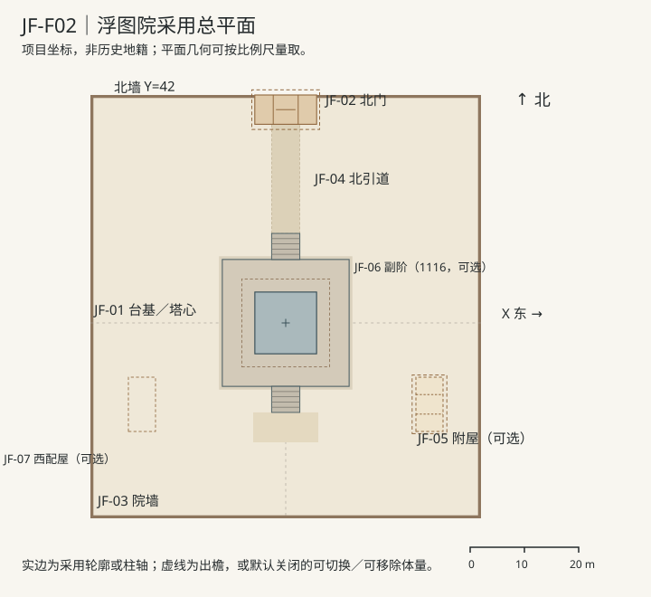

# 天宝长安 · 荐福寺浮图院复原资料

**基准：天宝九载（750）｜范围：院内建筑与场地｜重点：荐福寺塔（今小雁塔）**

[资产清单](asset-register.csv) · [小雁塔复原卡](pagoda.md) · [逐级尺寸 CSV](pagoda-levels.csv) · [院内单体卡](buildings.md) · [来源索引](sources.md)

## 范围与证据

这里的“荐福寺”指小雁塔所在的**浮图院**，不含街对面的开化坊大荐福寺本部，不建坊市、坊间街或现代景区。以北门内侧、院面和塔外为主要观看范围；不开放登塔或地宫。750 是同项目的场景基准，不表示目前资料能还原该年的每处砖木。

《唐两京城坊考》卷二安仁坊条记：“西北隅，薦福寺浮圖院。〈院門北開，正與寺門隔街相對。景龍中，宮人率錢所立。〉”[JF-S01](sources.md#jf-s01)。据此采用塔院及**向北的院门**，但不把门与塔共轴、院界、侧房数量当作史实。现代荐福寺的殿院序列不作为唐代塔院的建筑清单。

| 标记 | 含义 |
| --- | --- |
| **本址有据** | 本址文献、遗存或明确的建筑分期支持；只约束资料能证明的那个属性。 |
| **现代参照** | 现存同一遗存的形制、照片或公开尺寸转述；注明是否核到原图，不能直接当唐代实测。 |
| **类比** | 其他遗址、唐代图像或手册类型仅支持形制选择，不证明本院有同样的房屋。 |
| **灰模暂定** | 为完整复原方案给出的可取用几何；不等同于历史坐标或实测。 |

有明确本址证据时优先按证据；没有则优先借用同一遗存的现代几何，缺失部分采用类比或具体推定值。数值可用不等于数值已经证实。

## 院内建筑：证据分层

旧稿只列塔、北门、院墙和一栋附屋，那是可以落地的**建模最小集**，不是历史清点。文献既不能证明院内“只有”这几座，也不能证明还有哪些；因此本版不再用一句话交代建筑数量，而按证据强度分层：

| 层级 | 对象 | 能证明什么 | 本版处理 |
| --- | --- | --- | --- |
| **本址文献** | JF-01 塔、JF-02 北开院门 | 浮图院在安仁坊西北隅，院门北开，与街北寺门相对 | 默认建。门屋形制、门塔同轴仍是采用值。 |
| **本址后世文献** | JF-06 塔副阶 | 1116 年碑记塔外“周徊副屋”残破后修完，金末“缠腰”废尽；只能证明北宋存在 | 默认关闭，作可切换层；启用时必须标“1116 年碑所见”。 |
| **坊内位置参照** | 安仁坊西北角坊墙、角门、门外涵洞 | 坊墙厚约 `5` 米，角门距西北角约 `13` 米；塔至朱雀大街中轴线约 `190` 米 | 只用于院外定位，**不把坊墙当院墙**，不建坊市。 |
| **类比补设** | JF-05 东附屋、JF-07 西配屋 | 无本址证据；仅补足院落体量、检验尺度 | 默认关闭或可整栋移除，不影响塔—门关系。 |

再往下——正殿、钟鼓楼、经藏、僧房、满围回廊——在 750 年的塔院都没有本址证据，本版不建；这表示“没有依据”，不表示“当时一定没有”。拿到塔院考古或同期寺院布局研究后，按同一分层补卡，不把明清荐福寺轴线倒推回唐代。

## 总平面

*[JF-F01 证据关系图](figures/evidence-layout.svg)不按比例，仅说明四者关系；JF-F02 按项目米制坐标绘制，可量取，不能当作考古测绘。*

局部原点取**塔身中轴在院面上的投影**；`X` 向东、`Y` 向北、`Z` 向上，单位米。`Z=0` 为本版平院地坪，不是唐代地面高程。默认方案如下：

| 编号 | 对象 | 平面位置和标高 | 采用依据 |
| --- | --- | --- | --- |
| JF-01 | 荐福寺塔 | 中心 `(0,0)`；台基 `X/Y=-11.69–11.69`；上表面 `Z=3.20`（另说 `3.5`）。踏步在南北中部，外端 `Y=±16.49`。 | 塔体与方形砖台取现代参照；踏步长度与标高口径为本版采用值。 |
| JF-02 | 浮图院北门 | 门洞中线 `X=0`；柱轴范围 `X=-5.70–5.70, Y=36.60–42.00`；北侧入院。 | 北开有据；门塔同轴、门至塔心约39.3米及门屋尺寸均暂定。 |
| JF-03 | 院墙 | 外墙皮 `X=-36–36, Y=-36–42`；墙厚 `0.55`；北墙在 `X=-5.70–5.70` 留出门屋。 | 院落围合为采用方案；72×78米不是古代院界。 |
| JF-04 | 院面与步道 | 北引道 `X=-2.60–2.60, Y=16.49–36.60`；南踏步前空地 `X=-6–6, Y=-22–-16.49`；其余为连续院地。 | 行走路线为本版采用值，不指定古代礼仪路线。 |
| JF-05 | 东侧附屋（无名） | 柱轴 `X=24–29, Y=-20–-10`；面西，入口中线 `Y=-15`。 | 类比＋灰模暂定；默认不启用，不代表本址发现。 |
| JF-06 | 塔副阶（可切换） | 柱轴 `X/Y=±8.10`，五间，每间约 `3.24`；立于台面 `Z=3.20`；外檐口 `Z=7.50`。 | 仅1116年碑支持；默认关闭，见[单体卡](buildings.md#jf-06-塔副阶可切换)。 |
| JF-07 | 西侧配屋（无名，可移除） | 与 JF-05 镜像：柱轴 `X=-29–-24, Y=-20–-10`；面东。 | 纯类比补设，默认关闭，无本址证据。 |

门檐可越过北墙线，不另做墙外场景。默认方案只开 JF-01–JF-04：塔、北门、院墙与院面；JF-05、JF-07 是默认关闭的类比体量，JF-06 是默认关闭的北宋副阶，便于比较“最小集”和“补全方案”两种状态。院面保留相对开敞，让塔基和南北券门可从院内看清。**“默认关闭”是证据策略，不是历史判断**：它表示这些体量没有 750 年的本址依据，不表示当年不存在。

## 图版与取值

| 图表 | 用途 |
| --- | --- |
| [JF-F01 证据关系](figures/evidence-layout.svg) | 核对塔院、北向院门及与本部的关系；不量尺寸。 |
| [JF-F02 采用总平面](figures/court-plan.svg) | 量取院界、塔基、门屋柱网；虚线为可选的副阶与附屋。踏步和门屋细部以卡片为准。 |
| [JF-F03 塔南立面](figures/pagoda-south.svg) | 核对塔的逐级收分、密檐、开口和补全轮廓；数值以 CSV 和塔卡为准。 |
| [JF-F04 塔首层纵剖](figures/pagoda-section.svg) | 取台基、踏步、南北券门及塔室的关系；不推定唐代上部楼梯。 |

**尺寸可信度分三档。** 首层底边 `11.38`、总高 `43.395`、台基 `23.38` 见方：有公开测量转述，可按 `±0.1` 米级使用；首檐及第 2–13 级檐高：单张正面照片反算、未校正透视，建议按 `±0.3–0.5` 米使用；第 14–15 级、塔顶与塔刹：形制示意，只保证与下部的比例衔接。平面开间、门窗、墙厚、院墙尺度多为本版可画值，不是测绘。

拿到更可靠的测绘或修缮归属时，先改对应参数，再同步总图或立面。检查点：北门朝北、塔身方形、南北有券口而东西面不复制开口、首层突出于密檐段、十五级和塔刹区分清楚、副阶若开启必须标“1116 年碑所见”、现代震损与加固不混入750层。

## 仍缺的资料

- **院界与院墙**：没有浮图院本身的发掘；`72×78` 米只是场景边界，不是古代院墙。
- **院内建筑清单**：除塔、北开院门（本址文献）和副阶（北宋碑）外，没有可定址的单体；东西配屋纯属类比。
- **塔顶原状**：上部两级毁于 1556 年华州地震，现存为 1564 年合拢；《荐福殿堂图》只能示意，不能量尺。
- **副阶原状**：只剩“周徊副屋”四字与台基余量，开间、柱式、屋面全是推定。
- **砖作与色彩**：缺唐代原状检测；砖模数 `0.32×0.08` 与暖灰砖色均为暂定。
- **原始测绘与研究**：杨鸿勋、王龙飞、王毛真等文尚未取得原文；拿到后应优先替换第 2–15 级与塔顶参数。
