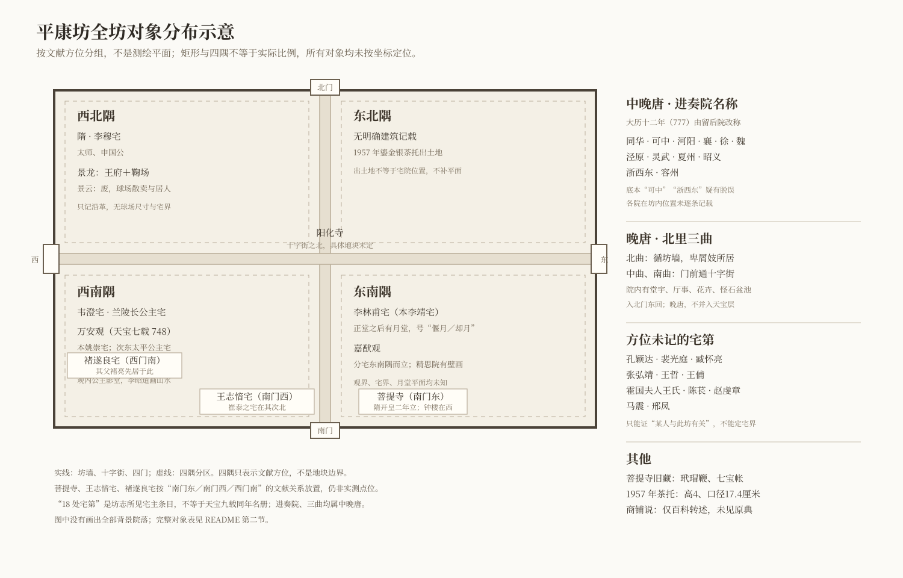
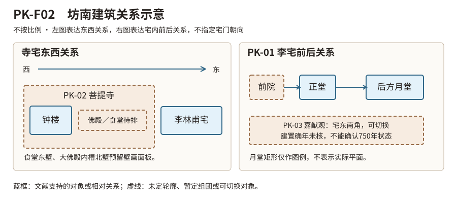
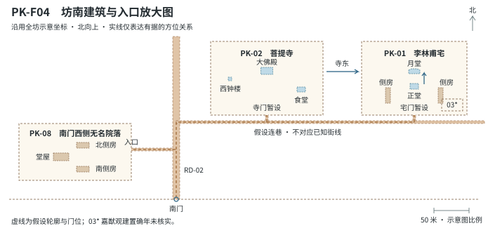

# 天宝长安 · 平康坊史料与布局示意

[天宝长安资料目录](../README.md) · [通用史料手册](../handbook/README.md) · [重点建筑专页](key-buildings.md) · [建模底图说明](basemap.md) · [证据索引 CSV](evidence-index.csv) · [引用与图版索引](#引用与图版索引)

## 年代与范围

以天宝年间为讨论范围，图版以天宝九载（750）为参照时点，不表示当年存在一张可复核的全坊平面。《长安志》为宋人追记，同一坊条往往并列不同时期的宅主与沿革；《北里志》提供晚唐信息，不能直接移到天宝。本文区分**文献所记、同城类比、示意排布和未知事项**。

本页是全坊主文档。菩提寺、李林甫宅、嘉猷观的逐项图版与“能证明／不能证明”，另见[重点建筑专页](key-buildings.md)。

## 一、坊的骨架

### 位置与邻坊

平康坊属万年县，位于皇城东南侧。北隔春明门街与崇仁坊相对，东邻东市，南邻宣阳坊。[PK-S01](#pk-s01)、[PK-S02](#pk-s02)

今西安和平门外建西街、建东街一带只是粗对应，不能据此配准唐代地块。

### 尺寸的两套数字

| 说法 | 数字 | 折算 | 限度 |
| --- | --- | --- | --- |
| 百科词条 | 东西650步、南北350步 | 约955.5×514.5米 | 未核原始测图 |
| 百科转述 | 东西1022米、南北500米 | — | 与上一说并列，不合并 |

两套数不能相加，也不能互相校正。全坊体块可按“东西略长于南北”的比例处理，不把任何一套写成实测。[PK-S01](#pk-s01)

### 坊门与街

| 要素 | 文献信息 | 限度 |
| --- | --- | --- |
| 南门 | 菩提寺在“南门之东”，王志愔宅在“南门之西” | 门位是否居中、门洞形制未知 |
| 西门 | 褚遂良宅在“西门之南” | 门位与西门街宽度未知 |
| 北门 | 《北里志》：“入北门，东回三曲” | 晚唐记载；天宝时同一门位是否存在未知 |
| 东门 | 百科概述“四面开门” | 未见本址文献或遗迹，暂作待核 |
| 十字街 | 阳化寺在“十字街之北”；南曲、中曲“门前通十字街” | 轴线、宽度、与四门是否对齐均未定 |
| 南街 | 《开天传信记》称李林甫旧宅在“平康坊南街” | “南街”是街名还是方位，待核 |

《北里志》的“入北门，东回三曲”是晚唐信息；《唐两京城坊考》引作“平康里入东回三曲”，少“北门”二字，版本有差异，不能据一种引文否定另一种。[PK-S05](#pk-s05)、[PK-S02](#pk-s02)

### 四隅

| 隅 | 文献所记 | 备注 |
| --- | --- | --- |
| 西北隅 | 隋太师、申国公李穆宅 | 景龙中其地为艮宁公王府及鞠场；景云中废，球场散卖与居人。是全坊少见的“宅第废为球场、再散卖”记载。[PK-S02](#pk-s02) |
| 西南隅 | 国子祭酒韦澄宅；兰陵长公主宅；万安观 | 万安观条称其地西南隅本姚元崇宅，次东为太平公主宅，后赐郭虔瓘，最终并为观。[PK-S02](#pk-s02)、[PK-S07](#pk-s07) |
| 东南隅 | 右相李林甫宅；嘉猷观 | 李宅本李靖宅，中经陆颂、李令问，后归林甫；嘉猷观分其宅东南隅而立。[PK-S02](#pk-s02)、[PK-S06](#pk-s06) |
| 东北隅 | 无明确建筑记载；1957 年鎏金银茶托出土地 | 茶托出土地不等于宅院位置，不能据此补出东北隅平面。[PK-S08](#pk-s08) |

*图 PK-F06｜按文献方位分组的对象示意，不是测绘平面。四隅只表示相对方位，对象均未按坐标定位；完整对象表见本文第二节。*

### 地块与布局

平康坊没有可复核的地籍图。现有材料只能支持“某对象在某隅、某门之东/西/南/北、某街之北”这一层关系；四隅内部的地块边界、宅与宅之间的巷、院与院之间的墙，均未见记载。图中背景院落只是空间组织示意，不对应已知唐代地籍。

## 二、全坊对象

坊志可见 **4 所寺观、18 处宅第、12 条进奏院名称**，以及晚唐北里三曲。这个数字是“坊志条目数”，不是天宝九载同年的建筑数量：同一地块可能先后换主，同一名称也可能跨不同年代。

### 2.1 寺观

| 对象 | 方位 | 关键记载 | 限度 |
| --- | --- | --- | --- |
| 菩提寺 | 南门之东 | 隋开皇二年（582）李敬道、僧惠英奏立；大中六年（852）改保唐寺；钟楼在西，因李林甫宅在东；有佛殿、食堂及吴道玄、郑法士壁画 | 天宝时已存在；殿址、院界无本址平面。[PK-S02](#pk-s02)、[PK-S03](#pk-s03) |
| 阳化寺 | 十字街之北 | 隋内史舍人于宣道为父建平公于义、母独孤夫人所立 | 隋寺；天宝时是否仍为寺、院落范围均待核。[PK-S02](#pk-s02) |
| 万安观 | 西南隅 | 天宝七载（748）永穆公主出家舍宅置观；其地本姚元崇宅，次东为太平公主宅，后赐郭虔瓘（底本作郭虔璀），最终并为观；观内有公主影堂，李昭道画山水 | 天宝七载的沿革较清楚；观界与殿宇无图。[PK-S02](#pk-s02)、[PK-S07](#pk-s07) |
| 嘉猷观 | 李林甫宅东南隅 | 李林甫奏分宅东南隅立观；玄宗御书金字额；林甫女为观主；精思院有王维、郑虔、吴道子壁画；林甫死后改为道士观 | 置观确年未得；观界、山门、殿宇无图。[PK-S02](#pk-s02) |

### 2.2 宅第

| 对象 | 方位 | 身份/年代 | 可用信息 |
| --- | --- | --- | --- |
| 李穆宅 | 西北隅 | 隋太师、申国公 | 后为王府及鞠场，景云中废，球场散卖；是坊内少见的空地变迁 |
| 韦澄宅 | 西南隅 | 国子祭酒 | 仅方位与身份 |
| 兰陵长公主宅 | 西南隅 | 太宗第十九女 | 李义府撰碑，称薨于平康里第 |
| 孔颖达宅 | 未记隅 | 国子祭酒、太子右庶子 | 于志宁撰碑，称薨于平康里第；底本作“孔颖逢” |
| 褚遂良宅 | 西门之南 | 尚书左仆射、河南郡公 | 其父褚亮先居于此 |
| 王志愔宅 | 南门之西 | 刑部尚书 | 与菩提寺隔南门东西相对 |
| 崔泰之宅 | 王志愔宅次北 | 户部尚书 | 只记相对位置 |
| 裴光庭宅 | 未记隅 | 侍中 | 张九龄撰碑，称薨于平康里第 |
| 臧怀亮宅 | 未记隅 | 左羽林大将军 | 李邕撰碑，称薨于平康里第 |
| 李林甫宅 | 东南隅 | 右相 | 本李靖宅；景龙中陆颂居，韦氏败后李令问居，后归林甫；正堂后有月堂；后分东南隅为嘉猷观 |
| 张弘靖宅 | 未记隅 | 太子宾客分司东都 | 本国子司业崔融旧第，有崔融题壁 |
| 王哲宅 | 未记隅 | 虔州刺史 | 《酉阳杂俎》记其治第，西偏掘地得石 |
| 王俌宅 | 未记隅 | 沂阳郡太守 | 王维撰其夫人成氏墓志，称薨于平康里第 |
| 霍国夫人王氏宅 | 未记隅 | 汾阳王郭子仪妻 | 杨绾撰碑，称终于平康里第 |
| 陈苌宅 | 未记隅 | 校书郎 | 柳宗元撰其亲属墓志，提及平康里 |
| 赵虔章宅 | 未记隅 | 河南府录事 | 孙溶撰墓志，称终于平康里私第 |
| 马震宅 | 未记隅 | 扶风马震 | 《续玄怪录》故事，称居长安平康里坊 |
| 邢凤宅 | 平康里南 | 帅家子 | 沈亚之《异梦录》称其“以钱百万质得故豪洞门曲房之第”，是文学形容，不是宅院平面 |

**读法：** 多数宅第只有“某人薨于平康里第”或“宅在某某之旁”一句，能证明**此人与此坊有关**，不能证明宅界、门向、院数。把它们全部画成同等大小的院落，会把不同年代、不同等级、不同记载性质混成一张图。

### 2.3 进奏院

《唐两京城坊考》平康坊条列：**同华、可中、河阳、襄、徐、魏、泾原、灵武、夏州、昭义、浙西东、容州进奏院**。[PK-S02](#pk-s02)

- “可中”“浙西东”疑为底本脱误，分别可能是“河中”“浙西、浙东”，需核对原卷。
- 进奏院的前身是“留后院”；大历十二年（777）改称进奏院。因此这份名单是**中晚唐**制度，不是天宝九载的机构名录；天宝时若画，应称留后院，且不能把名单全部前移。[PK-S02](#pk-s02)、[留后院及进奏院资料](../handbook/institutions.md)
- 各院在坊内的具体位置未见逐条记载，不能围着一个“进奏院区”平均排布。

### 2.4 北里三曲

《北里志·海论三曲中事》：“平康里。入北门，东回三曲，即诸妓所居之聚也。妓中有铮铮者，多在南曲、中曲。其循墙一曲，卑屑妓所居，颇为二曲轻斥之。其南曲、中曲，门前通十字街……二曲中居者，皆堂宇宽静，各有三数厅事，前后植花卉，或有怪石盆池，左右对设，小堂垂帘，茵榻帷幌之类称是。”[PK-S05](#pk-s05)

- **北曲**：循坊墙，地位较低。
- **中曲、南曲**：优妓所居，门前通十字街；院内有堂宇、厅事、花卉、怪石盆池、小堂垂帘。
- 这是**晚唐**的居住与行业分布，不是天宝九载的实测；三曲的精确走向、院落数量、与十字街的交点均未知。

### 2.5 其他

- **球场**：李穆宅旧址在景龙中为王府及鞠场，景云中废，球场散卖与居人。可说明坊西北曾出现开放场地，但不能定球场尺寸。[PK-S02](#pk-s02)
- **寺内旧藏**：菩提寺有“郭令玳瑁鞭及郭令王夫人七宝帐”，属寺产/器物记载，不是建筑。[PK-S02](#pk-s02)
- **商铺**：百科称留后院对面有珍珠、宝石、香料、金银器、丝织、漆物等店铺，但未见所引原典；暂列待核，不写进复原图。[PK-S01](#pk-s01)
- **器物**：1957 年平康坊遗址出土鎏金银茶托，高4厘米、口径17.4厘米，圈足刻“左策使宅茶库金涂拓子壹拾枚共重玖拾柒两伍钱一”，同出7件，一件刻“大中十四年八月造成”。出土地在坊东北隅。[PK-S08](#pk-s08)

## 三、重点建筑

*图 PK-F02 为关系图；PK-F04 是坊南假设布局的放大。坊南图的建筑矩形、门位和进院路线没有测绘依据；有依据的是文字所载的关系。*

### 菩提寺

《长安志》记“南门之东菩提寺”，隋开皇二年（582）立，大中六年（852）改称保唐寺。《寺塔记》称“菩萨寺”，记因李林甫宅在东而置钟楼于西；另记食堂东壁吴道玄《智度论色偈变》、大佛殿内槽北壁郑法士旧画。所载壁画位置与作者可查，画面原貌、殿和食堂的相互位置、钟楼层数与高宽均非该记载所能确定。[PK-S02](#pk-s02)、[PK-S03](#pk-s03)

同城参照可用西明寺东部院落的三进庭院、回廊台基；单体比例可用南禅寺大殿的三开间、柱高与举折。两者都不是菩提寺本址实测，详见[重点建筑专页](key-buildings.md#一菩提寺)。

### 李林甫宅与月堂

《长安志》记“东南隅右相李林甫宅”，又记此前为李靖宅；《寺塔记》记李宅在菩提寺之东。《开天传信记》说“林甫于正堂后别创一堂，制度弯曲，有却月之形，名曰月堂”；《太平广记》卷三百六十二引作“偃月堂”，《侯鲭录》等又作“却月堂”，三名并列。[PK-S02](#pk-s02)、[PK-S03](#pk-s03)、[PK-S06](#pk-s06)、[PK-S11](#pk-s11) 这说明笔记所述的前后关系，不说明宅门必朝南，也不说明“却月”具体指平面还是屋面。

《旧唐书》另有晚年“重扃复壁，络板甃石”的记载，不能据此推得地下通道或内院平面。正堂开间、柱距、屋顶、侧房和宅界未见本址测绘。[PK-S04](#pk-s04)

### 嘉猷观

《长安志》记李林甫奏分宅东南隅置观，观中精思院有王维、郑虔、吴道子壁画；《唐两京城坊考》另记玄宗赐金字额、林甫女为观主，并载“林甫死，后改为道士观，择道术者居之”。宅东南隅是相对方位；置观与赐额的确年、观院范围、匾额形制或壁画图像均未核实，沿革先后也需核对原卷。[PK-S02](#pk-s02)、[PK-S07](#pk-s07)

### 万安观

《长安志》称万安观，《唐会要》条称华封观，两书均记天宝七载（748）永穆公主舍宅置观。《唐两京城坊考》记其地在西南隅，本梁国公姚元崇宅，次东为太平公主宅，后赐安西都护郭虔瓘，最终并为观；观内公主影堂有李昭道画山水。两个名称不表示这里已证实有两座独立道观，旧宅方位也不宜强行合成精确点位。[PK-S02](#pk-s02)、[PK-S07](#pk-s07)

## 四、建模底图

- [天宝层 basemap-750.svg](figures/basemap-750.svg)：寺观、宅第、鞠场；有门/街/隅关系的用实线，推测范围用虚线，方位未记的 10 处宅第用浅色“分配假设”块。
- [晚唐层 basemap-860.svg](figures/basemap-860.svg)：保唐寺、嘉猷观、万安观、阳化寺、李林甫旧宅、北里三曲、12 条进奏院名称、茶托出土地。
- [底图说明与对象编号](basemap.md)、[basemap-objects.csv](basemap-objects.csv)。

两张图都是**示意底图**，不是测绘平面。图内坊墙按 1000×520 图稿单位绘制，导入建模软件时再按你选定的坊尺寸整体缩放；建筑矩形的大小、间距、朝向不能直接量取。天宝层和晚唐层是不同时间切片，不要叠成一张“全盛期”图。

## 五、道路、断面与入口

| 条目 | 资料与限度 |
| --- | --- |
| 坊北春明门街 | 坊北道路与相邻坊市的关系见[PK-S01](#pk-s01)、[PK-S02](#pk-s02)；本段路宽与断面未核实。 |
| 坊内十字街与南街 | 《北里志》有十字街；《开天传信记》称李宅旧址在“平康坊南街”。两条文字不能把图中的某条虚线认定为文献里的南街。[PK-S05](#pk-s05)、[PK-S06](#pk-s06) |
| 排水、墙与入口 | [布政坊道路与院落](../handbook/sources.md#s01)、[安仁坊角门及涵洞](../handbook/sources.md#s02)是同城对照，不是平康坊的沟宽、门洞或高差实测。现有材料也不足以确定该坊所有街巷的铺面。 |

[道路断面与入口关系图 PK-F05](figures/street-sections.svg)只示意可讨论的路面、边沟、门屋与院地关系，不表达平康坊已知断面。

## 六、地表、植被与生活器物

- **社会背景：**《开元天宝遗事》追述平康坊为“妓女所居之地，京都侠少萃集于此”，新进士亦游谒其中；《北里志》记进士、举子、三司幕府未通朝籍者可就诣。这些说明平康坊的游谒与宴饮功能，不支持具体院门、楼层或750年分布。[PK-S13](#pk-s13)、[PK-S05](#pk-s05)
- **植被与庭院：**《北里志》记南、中曲前后植花卉，部分有怪石盆池，并记小堂垂帘和帷幌。是特定范围的晚唐叙述，不是天宝坊内普遍陈设。[PK-S05](#pk-s05)
- **同城类比：**布政坊见路沟、井、水缸等，安仁坊宅邸见散水、排水沟；本页没有据此推定这些物件在平康坊的数量与位置。[通用水系资料](../handbook/landscape.md)
- **本址出土器物：**国博藏平康坊出土鎏金银茶托，高4厘米、口径17.4厘米；出土地不证明出于李宅或某间室内，也不单独确定750年的使用情境。[PK-S08](#pk-s08)

## 七、材质、色彩与外观资料

布政坊出土瓦件只提供该处瓦件的形态；山西南禅寺、佛光寺木构分别晚于天宝，且是佛殿；盛唐敦煌图像呈现殿、台基和回廊的图像关系，不是平康坊寺宅立面。[构件资料](../handbook/components.md)、[敦煌图像](../handbook/sources.md#s05)、[唐代木构](../handbook/sources.md#s06)

平康坊需另证的项目包括院墙与铺地材料、屋顶的具体构造和颜色、匾额外形及壁画图像。《寺塔记》的壁画方位不能补出原画，今存唐构或现代复原照也不能证明本址用色。坊墙的高度、厚度与夯土做法也没有本址实测。

## 八、证据与缺口

[证据索引 CSV](evidence-index.csv)按对象记录出处、资料年代、已知信息和证据限度。

优先待核：

1. **坊界与坊门**：尺寸两说，四门位置均未定；东门仅百科概述。
2. **十字街与南街**：只有文字关系，没有轴线、宽度、断面。
3. **四隅地块**：只有“某宅在某隅/某门之某”，没有宅界、巷格。
4. **寺观与宅第平面**：菩提寺、阳化寺、万安观、嘉猷观、李宅均无本址平立面。
5. **三曲走向**：晚唐文字，不能当天宝图。
6. **东北隅**：除茶托出土地外几乎空白，不应以想象填满。
7. **进奏院位置**：只有名称，没有逐院方位；且属777年后的制度。

图上虚线不因表达得更具体而增强证据。已经查过、暂未找到的，应写“已查，未见”，不拿相似建筑顶替。

## 九、引用与图版索引

- [PK-F01 坊区关系示意](figures/ward-layout.svg)：PK-S01、PK-S02、PK-S05。
- [PK-F02 寺宅与月堂关系](figures/south-blocks.svg)：PK-S02、PK-S03、PK-S06。
- [PK-F03 坊内布局示意](figures/interior-plan.svg)、[PK-F04 坊南观察示意](figures/south-detail.svg)：关系有出处；完整路网和地块是图示假设。
- [PK-F05 道路断面与入口关系](figures/street-sections.svg)：非测绘示意，无规格推荐。
- [PK-F06 全坊对象分布](figures/ward-objects.svg)：按四隅分组的对象索引；不是测绘平面。
- [PK-F07 天宝层建模底图](figures/basemap-750.svg)：寺观、宅第、鞠场；含分配假设块，不是测绘平面。
- [PK-F08 晚唐层建模底图](figures/basemap-860.svg)：保唐寺、三曲、进奏院、茶托出土地；不是测绘平面。

### PK-S01

百度百科 [《平康坊》](https://baike.baidu.com/item/平康坊/4950630)、[《平康巷》](https://baike.baidu.com/item/平康巷/9966034)，用于坊位、邻坊与词条转述的尺寸；原始测绘待核。

### PK-S02

〔宋〕宋敏求，[《长安志》卷八“唐京城二”](https://zh.wikisource.org/zh-hans/%E9%95%B7%E5%AE%89%E5%BF%97_(%E5%9B%9B%E5%BA%AB%E5%85%A8%E6%9B%B8%E6%9C%AC)/%E5%8D%B708)，查“崇仁坊”“平康坊”“宣阳坊”“东市”；对读〔清〕徐松[《唐两京城坊考》卷三](https://zh.wikisource.org/zh-hans/唐兩京城坊考/03)平康坊条，查四隅、寺观、宅第、进奏院与三曲。

### PK-S03

〔唐〕段成式，[《寺塔记》](https://zh.wikisource.org/zh-hans/寺塔記)“平康坊菩萨寺”条，查寺宅东西关系、钟楼及壁画。

### PK-S04

〔后晋〕刘昫等，[《旧唐书》卷一〇六《李林甫传》](https://zh.wikisource.org/zh-hans/舊唐書/卷106)，查“发丧于平康坊之第”“重扃复壁，络板甃石”。

### PK-S05

〔唐〕孙棨，[《北里志·海论三曲中事》](https://zh.wikisource.org/zh-hans/北里志)，用于晚唐北门、三曲、十字街及院落陈设。

### PK-S06

〔唐〕[《开天传信记》](https://zh.wikisource.org/zh-hans/開天傳信記)，查“平康坊南街废蛮院”；“废蛮院”是追述旧址的称谓，不是天宝门牌。

### PK-S07

〔宋〕王溥，[《唐会要》卷五十“尊崇道教”](https://zh.wikisource.org/zh-hans/唐會要/卷050)“华封观平康坊”条；对读《长安志》万安观条。

### PK-S08

中国国家博物馆，[《鎏金银茶托》](https://www.chnmuseum.cn/zp/zpml/kgfjp/202111/t20211116_252276.shtml)；马得志，《唐代长安城平康坊出土的鎏金茶托子》，《考古》1959年第12期，第679–681页（原刊线索）。

### PK-S09

《唐长安西明寺遗址发掘简报》，《考古》1990年第1期（原刊线索）；中国社会科学院考古研究所，《青龙寺与西明寺》，文物出版社，2015年，遗址总平面见第123页图66；李思洋，[《唐长安城西明寺东部院落遗址营造尺复原研究》](https://www.sohu.com/a/905617144_121119016)，《文物》2025年第3期。查东部院落的三进庭院、回廊台基、殿址间距与294毫米营造尺；柱础柱洞无存，不能反推柱网。

### PK-S10

张荣、王一臻、王麒、李玉敏，[《南禅寺大殿重建背景、材分营造制度分析及建筑像设空间布局研究》](https://thepaper.cn/newsDetail_forward_18883877)，《建筑史学刊》2022年第2期；祁英涛、柴泽俊，《南禅寺大殿修复》，《文物》1980年第11期，第61–75、102页。查三开间比例、平柱高13尺、五铺作斗栱与1:2.67举折；南禅寺晚于天宝，是佛殿，不是平康坊本址。

### PK-S11

〔宋〕李昉等，[《太平广记》卷三百六十二](https://zh.wikisource.org/zh-hans/太平廣記/卷第362)（出《开天传信记》），作“偃月堂”；对读《开天传信记》“月堂”、《侯鲭录》“却月堂”。三名并列，不据异文补出形制。

### PK-S12

中国新闻网，[《隋唐长安城考古首次发现宅邸遗址》](https://www.chinanews.com.cn/m/cul/2018/01-23/8431485.shtml)，2018-01-23；[《唐代里坊活化利用的当代答卷——唐长安城安仁坊遗址展示馆》](http://www.zhongguowenwubao.com/portal/DigitPager/paperDetail/publishdate/2025-09-13/paperId/21842/id/109144)，《中国文物报》，2025-09-13；DDB 秉仁，[安仁坊宅邸遗址分布图](http://www.archina.com/index.php?g=works&m=index&a=show&id=156714)。查西南隅10个房址、长廊、散水与排水沟；完整发掘平面尚未公开，不能量取院宽。

### PK-S13

〔五代〕王仁裕，[《开元天宝遗事》卷二“风流薮泽”](https://zh.wikisource.org/zh-hans/開元天寶遺事/卷二)，用于平康坊游谒、宴饮的社会背景；不支持具体院门、楼层或750年空间分布。
