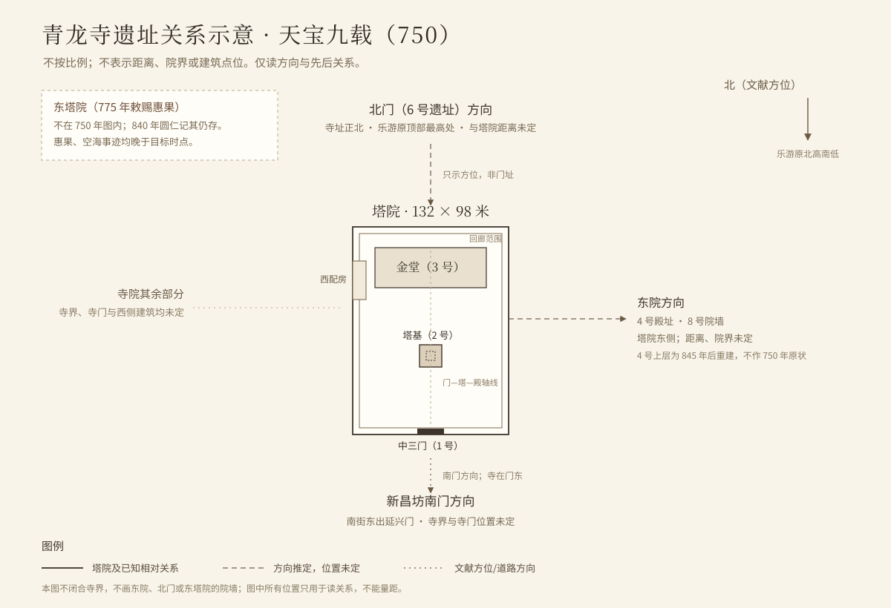

# 青龙寺塔院复原 · 天宝九载（750）

**能用于天宝复原的，首先是新昌坊南门之东的寺位、隋灵感寺塔院“前塔后殿”的格局和主要台基尺寸；木塔层数、上部形制、寺界、东院与北门的确切位置均未定。**

[建筑群复原模板](../ensemble-template.md) · [来源索引](sources.md) · [塔基与木塔详条](pagoda.md) · [单体卡](buildings.md) · [资产清单](asset-register.csv) · [平面数据](data/README.md)

## A0 编纂说明

- **目标时点**：天宝九载（750）。史籍、佛典、考古报告、现代介绍各自的实际年代在 A1、C1 和 `sources.md` 中分列；唐宋追述只用于判断 750 年的存在与格局，不当作同年实测。
- **历史范围**：唐长安外郭城新昌坊东南部的青龙寺。寺院历史可上溯隋开皇二年（582）灵感寺，历唐武德废、龙朔复立、景云改名；会昌毁佛后改护国寺，大中复名，宋以后渐废。本专项的**正式总平面只覆盖塔院**（1、2、3、5、7 号遗址），不画全寺闭合边界。
- **纳入与排除**：纳入 750 年塔院的中三门、塔基（木塔）、金堂、回廊、西配房；A2 另列东院殿址（4 号）、东院院墙（8 号）、北门（6 号）、窑址（Y1–Y3）和寺界/坊位，因位置、年代或边界未定，**不进入正式总图**。大历十年（775）始见的东塔院、惠果与空海事迹、会昌后重修的 4 号上层殿、宋以后及现代景区设施，均不作为 750 年布局依据。
- **交付与裁切**：交一份考证说明、一套塔院局部坐标的 GeoJSON 与同源 PNG、一幅不按比例的关系图。**不做木塔、金堂的上部立面或剖面复原**；不建街道、坊墙、现代纪念堂或景区广场。图面裁切不表示历史院界。
- **坊级衔接**：仓内没有可引用的新昌坊专项编号或固定总图。本版据《长安志》卷九“南街东出延兴门”“南门之东青龙寺”作文本定位，寺在坊东南部；不抄坊级示意坐标，也不把“寺址 500×250 米”等二手范围当作坊内四至。局部坐标未与全城底图配准。

## A1 沿革与分期

| 年代／阶段 | 对象与事件 | 出处定位、材料时间与核验状态 | 本期用途 |
| --- | --- | --- | --- |
| 隋开皇二年（582） | 立灵感寺；相传为隋文帝迁葬城中陵墓、超度亡灵而置 | 《长安志》卷九 [QL-S01](sources.md#ql-s01)，已核北宋追述；陕西省地方志办公室综述 [QL-S09](sources.md#ql-s09)，已核网页 | 支持寺的始建与塔院“前塔后殿”可能始于隋；不把迁葬传说当作平面证据 |
| 唐武德四年（621） | 寺废 | [QL-S01](sources.md#ql-s01)、[QL-S02](sources.md#ql-s02)，已核在线文本 | 说明 750 年以前有废而复立，不据此判断建筑连续存在 |
| 龙朔二年（662） | 复立为观音寺；公主名有异文 | [QL-S01](sources.md#ql-s01) 作“城阳公主”，[QL-S02](sources.md#ql-s02) 作“新城公主”，均已核在线文本 | 两说并列，不擅自定字；支持 662 年复立 |
| 景云二年（711） | 改名青龙寺 | [QL-S01](sources.md#ql-s01)、[QL-S02](sources.md#ql-s02) | 750 年额名依据 |
| **天宝九载（750）** | **目标时点：寺存在，塔院、塔、金堂等已有；东塔院尚未建** | 由隋唐塔院遗存与 775 年东塔院记载反推；塔院格局见 [QL-S08](sources.md#ql-s08)，775 年见 [QL-S04](sources.md#ql-s04) | 正式平面的时间边界；不把 775 年以后对象回填 |
| 大历十年（775） | 代宗敕赐惠果“东塔院一所”，置毗卢遮那灌顶道场，七僧持念 | [QL-S04](sources.md#ql-s04)，已核 CBETA 在线全文 | **东塔院最早定点记载，排除于 750 年总图**；只作后世参照 |
| 大历年间（766–779） | 惠果将恩赐钱物“一千余贯，尽修塔下功德”；行状见“青龙大佛殿”“当寺大佛殿” | [QL-S04](sources.md#ql-s04) | 支持 8 世纪后期塔与大殿存在；不提供开间、层数或塔刹 |
| 贞元十九年至二十一年（803–805） | 空海入唐，贞元二十年（804）拜惠果；惠果贞元二十一年（805）十二月十五日卒 | [QL-S04](sources.md#ql-s04) | 晚于 750 年，不作布局依据；可作东塔院以后的师资背景 |
| 开成五年（840） | 圆仁记东塔院有义真、法润，分别解胎藏、金刚界 | [QL-S05](sources.md#ql-s05)，已核在线文本 | 9 世纪东塔院仍存；不能回推 750 年 |
| 会昌五年至六年（845–846） | 禁佛，寺废；会昌六年五月改护国寺 | [QL-S02](sources.md#ql-s02)、[QL-S09](sources.md#ql-s09) | 说明 4 号上层殿、北门毁废等后世事件；不作 750 年原状 |
| 大中九年（855） | 恢复青龙寺本名 | [QL-S08](sources.md#ql-s08)、[QL-S09](sources.md#ql-s09)；《旧唐书》原文待核 | 晚唐复名；不影响 750 年平面 |
| 北宋元祐元年（1086）以后 | 寺院渐废，地面建筑无存 | [QL-S09](sources.md#ql-s09)，已核网页；具体废毁过程待核 | 说明今日遗址为地下基址，不是唐代地面 |
| 1963–1992 | 1963 年调查；1973–1980 年发掘；1992 年配合仿唐庭院发掘 | [QL-S08](sources.md#ql-s08)、[QL-S09](sources.md#ql-s09) | 考古尺寸的来源背景；发掘所见与复原取舍分开 |
| 2010–2012 | 塔院遗址保护展示；遗址景区落成；博物馆开放 | [QL-S08](sources.md#ql-s08)、[QL-S10](sources.md#ql-s10) | 现代景区对象，不纳入 750 年 |

## A2 对象总表与建筑群布局

### 对象总表

| 编号与名称 | 归属／阶段 | 750 年状态 | 位置／关系精度 | 出处与处理 |
| --- | --- | --- | --- | --- |
| QL-01 塔院 | 青龙寺塔院；遗存主体可能始于隋 | 有据 | 南北 132 米、东西 98 米；局部图全覆盖 | [QL-S08](sources.md#ql-s08)；正式平面外框，边界是塔院范围，不是独立院墙 |
| QL-02 中三门（1 号遗址） | 塔院南门；唐代 | 有据；晚唐废毁后门道被封 | 南边界中央；东西 17 米、残存南北 2.94 米；门道净宽 5.83 米 | [QL-S08](sources.md#ql-s08)；正式平面，见 A3 |
| QL-03 塔基／木塔（2 号遗址） | 塔院中部偏南；隋唐 | 有据；木结构塔 | 方形；南距中三门 23.4 米，北距金堂 47 米；15 米边长为二手转引 | [QL-S08](sources.md#ql-s08)、[QL-S11](sources.md#ql-s11)；正式平面，见 [pagoda.md](pagoda.md) |
| QL-03-PIT 塔心坑 | 塔基中央；舍利地宫 | 有据 | 近方形，边长约 4 米、深 1.8 米 | [QL-S08](sources.md#ql-s08)；正式平面用细线表示，不画上层塔身 |
| QL-04 金堂（3 号遗址） | 塔院北部；分早晚两期，复原早期基址 | 有据 | 夯基 57.2×26.2 米；南侧月台 13.2×5 米；东西慢道宽 3 米 | [QL-S08](sources.md#ql-s08)；正式平面只画台基轮廓，不画柱网 |
| QL-05 回廊（5 号遗址） | 塔院四围 | 有据 | 宽 3.33 米；实测周长 440 米；沿中轴对称 | [QL-S08](sources.md#ql-s08)；正式平面分段表示，门址与西配房处断开 |
| QL-06 西配房（7 号遗址） | 塔院西部；侧门门房 | 有据 | 南北 22.57 米、东西 8.40–10.09 米；西南外扩 | [QL-S08](sources.md#ql-s08)；正式平面取 9.25 米示意宽度 |
| QL-07 东院殿址（4 号遗址） | 塔院东侧另院；下层隋、上层晚唐 | 下层隋建筑有据；750 年地面建筑是否沿用下层，报告未明 | 东院，位置偏南，与塔址东西相对；与塔院距离未定 | [QL-S08](sources.md#ql-s08)；**不入正式总图**，见 A3 与 [buildings.md](buildings.md#ql-07-东院殿址4-号) |
| QL-08 东院院墙（8 号遗址） | 东院 | 仅知墙址存在；年代、范围未定 | 东院院墙，具体尺寸/四至未公布 | [QL-S08](sources.md#ql-s08)；**不画**，留 A2 与待查 |
| QL-09 北门（6 号遗址） | 寺北门；乐游原顶部 | 750 年很可能存在；可能建门楼，845 年毁后未复 | 寺址正北，与塔院距离未定；门道宽 6 米以上、进深 5 米以上 | [QL-S08](sources.md#ql-s08)；**不入正式总图**，只作关系图方位 |
| QL-10 东塔院 | 青龙寺内另一塔院 | **775 年始见，750 年排除** | 位于寺内东部；与塔院、东院距离均未定 | [QL-S04](sources.md#ql-s04)、[QL-S05](sources.md#ql-s05)；只作后世参照 |
| QL-11 寺界／坊位 | 新昌坊东南部 | 寺在坊南门之东有据；界址未定 | 不闭合；无四项实测边界 | [QL-S01](sources.md#ql-s01)、[QL-S02](sources.md#ql-s02)；只作文本定位 |
| QL-12 窑址 Y1–Y3 | 寺院窑场？ | 年代未定；可能晚于 750 | 寺址内，具体位置/范围未列 | [QL-S08](sources.md#ql-s08)；**不纳入 750 年** |

**编号说明**：GeoJSON 为避让中三门和西配房，把回廊拆成 `QL-05-SW/SE/N/WN/WS/E` 六段，把慢道拆成 `QL-04-RAMP-E/W`；A2 仍以 `QL-05`、`QL-04` 为组。`QL-LBL-CORRIDOR`、`QL-DIM-NS`、`QL-DIM-EW` 只是图面标注，不另立建筑对象。

### 空间关系

- **坊街与出入口**：《长安志》卷九“南街东出延兴门”“南门之东青龙寺”[QL-S01](sources.md#ql-s01) 可定寺在新昌坊南门以东、坊东南部；寺门、南门与塔院中三门是否同轴，文献未载，不能把坊南门直接当作寺门。塔院中三门是塔院门，不是全寺山门。
- **文献与遗迹对应**：塔院“前塔后殿”由中三门—塔基—金堂构成，1、2、3、5、7 号遗址的编号和相对关系见 [QL-S08](sources.md#ql-s08)。这是**发掘者的布局解释**；本版采用其相对次序，但不把“隋灵感寺所建”当作每座台基的绝对年代。
- **院界与分院**：塔院 132×98 米有明确转引，但四周是回廊外缘还是独立院墙，报告未逐段说明；正式平面用“塔院范围”外框，不称院墙。东院在塔院东侧，4 号殿址与塔址东西相对；东院院墙（8 号）范围、东院与塔院之间的距离均未公布，故不画东院轮廓。
- **轴线与单体**：塔院南北中轴线上依次为中三门、塔基、金堂；西配房在塔院西部，东侧经慢道接金堂，南北接回廊。东配房在已核综述中未给出与西配房对称的尺寸，正式平面**不补画东配房**，以免用镜像冒充遗存。
- **北门与寺界**：北门在寺址正北、乐游原顶部最高处，与塔院距离未定；寺界未闭合。关系图只标“北门方向”和“东院方向”，不按距离排布。
- **地坪与高差**：乐游原北高南低，寺“北枕高原”；唐代院面、街面高程和排水坡度未定。正式平面使用平院坐标，`Z=0` 是项目展示地坪，不是唐代标高。
- **坐标与总图**：局部原点取塔院西南角 `(0,0)`，`X` 向东、`Y` 向北，单位米；塔院范围 `X=0–98`、`Y=0–132`。未作考古或地理配准；图面“上北”是项目坐标北，不是测绘真北。

### 总平面

正式总平面只覆盖塔院，见 [`data/ensemble-plan.geojson`](data/ensemble-plan.geojson) 与 [`data/manifest.json`](data/manifest.json)。图题、图注和生成命令见 [`data/README.md`](data/README.md)；PNG 在本地生成，不入 Git。

塔院外框不是闭合寺界；东院、北门、东塔院、窑址和寺界均不画入本图。东院、北门与塔院的方向关系另见不按比例的 [关系图](figures/site-relations.svg)。



**读图限制**：图中塔基 15×15 米是二手转引的占位；金堂只画台基，不画“面阔十三间、进深五间”的柱网；回廊只画宽度带，不画柱列和屋顶；西配房宽度取 8.40–10.09 米的中值示意。任何一条边线都不应被读成未经说明的唐代实测。

## A3 重点单体详条

### QL-02 · 中三门（1 号遗址）

- **分期与辨识**：塔院南门，夯土基址东西 17 米，残存最宽 2.94 米，保存厚 0.5–0.7 米；门道在中央，东西残存最宽 5.83 米；门基址东西两侧与 5 号回廊相接。[QL-S08](sources.md#ql-s08) 另记唐代晚期中三门废毁，另起新廊将门道封闭。
- **平面与通行**：正式平面把 17 米作为东西向台基宽度，把 2.94 米作为**残存南北宽度**，不把它当作原门屋进深。门道净宽 5.83 米是残存最宽值，原门道宽度、门扉位置、门槛和踏道均未定。
- **立面与屋顶**：原门屋开间、进深、柱网、屋顶形式、台明高度和门楼有无，已查材料均未载。**不做上部复原**；图上只以低矮门基占位，不能据“中三门”之名补三间门屋。
- **材料与年代**：夯土门基，保存厚度 0.5–0.7 米；夯层、土色和包含物未在已核综述中给出。晚唐封堵门道是后世改筑，不能回填为 750 年状态。

### QL-03 · 塔基与木塔（2 号遗址）

- **分期与辨识**：塔院中部偏南，南距中三门 23.4 米，北距金堂 47 米；方形塔基，五花夯土厚 1.6–2.0 米；中央近方形坑边长约 4 米、深 1.8 米，应为塔心舍利地宫，破坏彻底、无遗物。[QL-S08](sources.md#ql-s08) 判断“应为隋唐常见木结构佛塔”。
- **平面与通行**：本版采用正方形塔基，边长 15 米为**二手转引，未核**（[QL-S11](sources.md#ql-s11)）；塔心坑 4×4 米，位于塔基中央。塔基外缘、台明、踏道、塔门和塔内楼梯均未定；塔心坑不是上层塔身平面。
- **立面与层数**：**层数、总高、每层檐口、平坐、栏杆、塔刹形制均无直接记载或发掘证据。** 不采用“隋唐常见木塔”补出五层、七层或任何层数；不做外观立面图。若展示需要体量，只能标为“类型学备选”，不得进入本版正式图。
- **剖面与构造**：仅知夯土塔基和中央地宫坑；塔身柱网、地栿、楼层、暗层、壁体、斗栱、屋面做法均未定。**不画上部剖面**；地宫只标平面范围和深度，不补券顶、甬道或舍利容器。
- **复原边界**：可以确认“此处有一座方形木塔的塔基”；不能确认塔的外观。详见 [pagoda.md](pagoda.md)。

### QL-04 · 金堂（3 号遗址）

- **分期与辨识**：塔院北部，分早晚两期重叠，晚期规模略小；本版复原**早期基址**。夯基东西 57.2 米、南北 26.2 米，五花夯土厚 1.6–2.0 米；南侧正中月台东西 13.2 米、南北约 5 米；东西两端各伸出宽 3 米的夯土，应为东西慢道。[QL-S08](sources.md#ql-s08)
- **平面与柱网**：报告称早期面阔十三间、进深五间、间距纵横约 4 米，但 57.2×26.2 米与 13×5 间不能简单整除，且未给柱径、柱础位置和收分。**正式平面只画台基轮廓，不画柱网**；月台按已知尺寸画，慢道只画已知宽度：西慢道从西配房东缘接到金堂西缘（约 11.15 米），东慢道画 6 米，长度均非实测。
- **立面与屋顶**：金堂开间、柱高、斗栱、屋顶形式、鸱尾、门窗和色彩均未载。**不做上部复原**；不能据“金堂”之名补重檐或庑殿顶。
- **材料与年代**：夯土台基；台基包砖、阶条、散水、地面铺装均未在已核综述中说明。早期台基与晚期台基的绝对年代、废弃层位待核；不能把晚期较小台基当作 750 年原状。

### QL-05 · 回廊（5 号遗址）

- **分期与辨识**：绕塔院四围，西廊保存较完整，南部破坏严重；沿塔院南北中轴线左右对称；实测周长 440 米、宽 3.33 米、残高 0.3–0.5 米；台基上散见柱础石和壁砌瓦片柱洞。[QL-S08](sources.md#ql-s08)
- **平面与通行**：正式平面按 3.33 米宽沿四边内侧布置；南廊在中三门门址处断开，西廊在西配房处断开，北廊、东廊连续。分段只为避让已知门址和配房，不表示每段都是独立建筑。
- **柱网与立面**：柱网、开间、柱径、檐口、屋顶和墙体均未定；不画柱列，不做立面。440 米周长与 98×132 米矩形的 460 米理论周长相差 20 米，说明回廊可能切角、随地形偏折或测量口径不同；**不强行闭合**，也不据 440 米反推院界。
- **材料与年代**：台基、柱础石、瓦片柱洞说明有木构廊；具体始建、重修和晚唐封堵门道后的改筑待核。

### QL-06 · 西配房（7 号遗址）

- **分期与辨识**：塔院西部，东侧通过慢道与金堂相连，南北两侧与回廊相接；南北 22.57 米，东西 8.40–10.09 米，西南部往外延伸一部分；东侧中部接金堂西慢道，向西有延出的辅砖道；中间为东西向穿堂门道，可出入塔院，相当于塔院侧门门房。[QL-S08](sources.md#ql-s08)
- **平面与通行**：正式平面取东西宽 9.25 米作为 8.40–10.09 米的中值示意，南北按 22.57 米；穿堂门道位置按“中间”表示，门洞宽度、门扉和踏道未定。西南外扩形状未详，图中不画外扩。
- **立面与屋顶**：开间、层数、屋顶、台明和墙体做法均未载；**不做上部复原**。不能因“配房”之名补成对称厢房。
- **材料与年代**：与回廊、金堂慢道相接，说明是塔院内的附属建筑；始建和重修年代未定。

### QL-07 · 东院殿址（4 号）与 QL-08 · 东院院墙（8 号）

- **QL-07**：东院殿址位于塔院东侧，位置偏南，与西侧塔址东西相对；仅存台基，早晚两期重叠；总体东西 28.75 米、南北 21.75 米；下层为隋灵感寺建筑遗存，面阔进深均五间；上层为 845 年灭佛后重建的唐晚期殿址，面阔五间、进深四间；1984 年基本保护。[QL-S08](sources.md#ql-s08)
- **750 年判断**：下层是隋代建筑，但报告未说明它在 750 年是否仍在地面、是否已改建或废弃；上层明确晚于 845 年，不能当作 750 年建筑。因此本版只记“东院有隋代殿址，750 年地面状态待核”，**不把 4 号殿画入正式总图**。
- **QL-08**：仅知东院院墙墙址存在，具体尺寸、范围、门址和年代未在已核综述中给出；**不画院墙、不闭合东院**。东院与塔院的距离也未定，不能用“东西相对”换算成坐标。

### QL-09 · 北门（6 号遗址）

- **分期与辨识**：位于青龙寺遗址正北、乐游原顶部最高处；仅残存部分门基夯土、门道路土和车辙；门址形制不明；门道宽应在 6 米以上，进深 5 米以上；出土鎏金铜泡钉；可能建有门楼，唐武宗灭佛时被毁，其后未见恢复。[QL-S08](sources.md#ql-s08)
- **750 年判断**：北门在 845 年毁，说明此前存在；但始建年代、门楼形制和 750 年是否已有门楼均未定。可以写“750 年很可能有北门”，不能写“750 年北门为某式门楼”。
- **平面与复原边界**：与塔院距离未定，**不入正式总图**；关系图只标“北门方向”，不按比例。门道 6 米、进深 5 米是下限，不是复原尺寸；不补门屋开间、屋顶、墩台或门扇。

## A4 复原方案与取值

### 取值表

| 对象／部位 | 本版采用值（米） | 测点／基准 | 证据状态与限制 |
| --- | --- | --- | --- |
| QL-01 塔院范围 | 东西 `98`、南北 `132` | 塔院外缘；局部原点在西南角 | 转引 [QL-S08](sources.md#ql-s08) 的发掘尺寸；未核原书测点。外框是范围线，不是独立院墙 |
| QL-02 中三门台基 | 东西 `17`、南北 `2.94` | 夯土东西长；南北为**残存最宽** | 转引实测；2.94 米不是原门屋进深。门道净宽 `5.83`，同为残存值 |
| QL-03 塔基 | `15×15`，中心 `(49, 30.9)` | 台基外缘；南距中三门 `23.4`，北距金堂 `47` | 15 米为 [QL-S11](sources.md#ql-s11) 二手转引，**未核**；方形和相对位置有据 |
| QL-03-PIT 塔心坑 | `4×4`，深 `1.8` | 坑口边长；从塔基面起算 | 转引实测；不画上层塔身、券顶或甬道 |
| QL-04 金堂台基 | 东西 `57.2`、南北 `26.2` | 夯基外缘；南缘距塔基北缘 `47` | 转引实测；早期基址。柱网不按 4 米硬分 |
| QL-04-YUETAI 月台 | 东西 `13.2`、南北 `5` | 南侧正中，贴金堂南缘 | 转引实测；南北 5 米为“约”值 |
| QL-04-RAMP-E/W 慢道 | 宽 `3`；东段长约 `6`，西段约 `11.15`（均示意） | 金堂东西两端外侧；宽度有据，长度无据 | 宽 3 米为转引；西段按西配房—金堂间距拉通，东段 6 米仅示位置，`inference: schematic` |
| QL-05 回廊 | 宽 `3.33`；计划周长按矩形分段 | 廊基外缘；沿塔院四边内侧 | 宽、440 米周长转引实测；柱网和屋顶未定，440 与 460 米不强行闭合 |
| QL-06 西配房 | 南北 `22.57`、东西 `9.25`（示意） | 台基外缘；南北有据，东西取 `8.40–10.09` 中值 | 宽度区间为转引实测；9.25 为示意图值，西南外扩未画 |
| QL-09 北门 | 门道宽 `>6`、进深 `>5`（下限） | 门址残存；未定测点 | 转引；**不进入总图**，不补门楼 |
| 坐标与竖向 | `X` 东、`Y` 北、`Z` 上；`Z=0` 项目地坪 | 塔院西南角 `(0,0)` | 项目坐标，不是考古坐标；未作地理配准；无唐代高程 |

### 方案选择

1. **塔基边长取 15 米**：官方综述只称“正方形”，未给边长；15 米来自二手线索。取 15 米是为了让塔基、塔心坑和南北距离在同一图上可读，并把不确定性写进 `grade: B`、`inference: likely` 和图注。若后续核到原报告，应整体替换，不同时保留两套。
2. **南北距离取 23.4 米 + 47 米**：这两个数能从中三门南缘经塔基到金堂南缘连续相加；报告另见“塔基以北 43 米”“南距中三门 82 米”，与前者不一致。本版不混用，A4 待查列明。
3. **金堂只画台基**：57.2×26.2 米与“面阔十三间、进深五间、间距约 4 米”不能简单整除；在柱网未核前不画柱列，避免用等分网格制造假精度。
4. **回廊分段不闭合**：南廊让开中三门，西廊让开西配房；不把 440 米周长硬套到 98×132 米矩形上。图中段与段之间的缺口是避让，不是门址以外的通道证据。
5. **不做上部复原**：木塔层数、高度、檐口、塔刹，金堂开间、屋顶、斗栱，门屋和配房立面均无直接证据；本版只交平面和关系图，不用类型学补足冒充本址复原。

### 待查表（B4）

| 问题及当前状态 | 已查范围与下一步 | 影响 |
| --- | --- | --- |
| 塔基边长 15 米无原始出处 | 已核 [QL-S08](sources.md#ql-s08) 只称“正方形”；[QL-S11](sources.md#ql-s11) 为二手。待核 [QL-S06](sources.md#ql-s06)、[QL-S07](sources.md#ql-s07) 的塔基平面图、探方号和边长测点 | 决定正式平面塔基大小和塔心坑相对位置；未核前 15 米只能作占位 |
| 23.4、47、43、82 米四组距离不能同时成立 | 已核 [QL-S08](sources.md#ql-s08) 原文并列；待核原报告的距离起止点（南缘/北缘/中心）和是否含月台、慢道 | 决定塔基—金堂间距和总图南北序列；本版取 23.4+47，不声称唯一解 |
| 3 号殿“十三间×五间、间距 4 米”与 57.2×26.2 米不一致 | 已核综述；待核原报告柱网图、柱础编号和间数统计口径 | 决定是否画柱网；未核前只画台基 |
| 中三门原进深、开间、屋顶、门楼形制 | 已核 [QL-S08](sources.md#ql-s08) 仅给夯土残存尺寸；待核 1979 年发掘平面和立面复原研究 | 决定门屋体量；未核前不补三间门屋 |
| 回廊 440 米与 98×132 米矩形周长 460 米相差 20 米 | 已核综述；待核回廊平面图是否切角、随坡偏折，或 440 米是否为轴线/外缘的不同口径 | 决定回廊是否能闭合成矩形；本版分段不闭合 |
| 西配房西南外扩形状、穿堂门道宽度 | 已核 [QL-S08](sources.md#ql-s08) 只述“往外延伸一部分”；待核 7 号遗址平面图 | 决定西配房轮廓和侧门通行；本版不画外扩 |
| 东院 4 号殿与塔院距离、8 号院墙范围 | 已核综述只给 4 号殿总体尺寸和“东西相对”；待核 [QL-S07](sources.md#ql-s07) 东院遗迹图 | 决定东院能否进入总图；未核前只作方向关系 |
| 4 号下层隋殿在 750 年是否仍在地面 | 已核综述分下层隋、上层晚唐；待核层位、废弃面和同期遗物 | 决定 750 年东院是否有殿；不能把上层晚唐殿当前身 |
| 北门与塔院距离、门楼形制、始建年 | 已核 [QL-S08](sources.md#ql-s08) 只给位置、门道下限和 845 毁；待核 6 号遗址平面、道路走向和门楼构件 | 决定北门能否定位；未核前只标方向 |
| 寺界、寺门位置、新昌坊内四至 | 已核《长安志》《唐会要》文字；待核坊墙勘查、延兴门遗迹和寺址范围测绘 | 决定全寺总图能否成立；本版不画闭合寺界 |
| 窑址 Y1–Y3 的年代与性质 | 已核 [QL-S08](sources.md#ql-s08) 仅称“可能为寺院窑场”；待核窑具、烧土和地层 | 决定是否纳入 750 年；本版不纳入 |
| 龙朔二年复立为观音寺的公主名 | [QL-S01](sources.md#ql-s01) 作城阳、[QL-S02](sources.md#ql-s02) 作新城；待核两书版本及唐代墓志 | 影响沿革表述，不影响平面；本版并列 |
| 大中九年复名的《旧唐书》原文 | 已核 [QL-S08](sources.md#ql-s08)、[QL-S09](sources.md#ql-s09) 综述；待核《旧唐书·宣宗纪》或相关诏敕 | 影响晚唐沿革；不影响 750 年 |

## C 附录

### C1 来源

[来源索引 QL-S01–QL-S11](sources.md) 分列史籍、佛典、考古报告转引、现代介绍和二手线索。考古尺寸以 [QL-S08](sources.md#ql-s08) 的 2025 年官方综述为主要可核网页来源；[QL-S06](sources.md#ql-s06)、[QL-S07](sources.md#ql-s07) 原书未核，正式引用前须回查图版与测点。

### C2 图版与附件

| 图版／附件 | 用途及量取限制 |
| --- | --- |
| [`data/ensemble-plan.geojson`](data/ensemble-plan.geojson) | 塔院正式平面数据；只覆盖 1、2、3、5、7 号遗址相关对象，不画东院、北门、寺界 |
| [`data/manifest.json`](data/manifest.json) | 生成 `ensemble-plan` PNG 的清单；图题、图注和坐标说明见 [data/README.md](data/README.md) |
| [`figures/site-relations.svg`](figures/site-relations.svg) | 塔院、东院、北门、坊街和东塔院的方向关系；**不按比例**，不表示距离、院界或建筑点位 |
| 本地生成的 `ensemble-plan.png` | 由绘图器输出到 `build/figures/agent/changan-tianbao/qinglong/ensemble-plan.png`，不入 Git；用于检查线型、标注和未闭合边界 |
| 木塔上部 | **本版不做**。本址只有方形塔基，层数、高度、檐口、塔刹无据；不提供类型学外观图，以免被误读为复原 |

生成与校验命令（从仓库根目录运行）：

```bash
pnpm render:ward --manifest "reconstructions/changan-tianbao/qinglong/data/manifest.json" --check
pnpm render:ward --manifest "reconstructions/changan-tianbao/qinglong/data/manifest.json" \
  --png-dir "build/figures/agent/changan-tianbao/qinglong"
```

### C3 修订记录

- 2026-11-28：初版。建立青龙寺天宝九载塔院专项；以 1973–1980 年发掘的 1、2、3、5、7 号遗址为正式平面范围，东院、北门、东塔院、窑址和寺界另列；塔基边长 15 米明确标为二手转引，不补木塔层数或上部形制。
